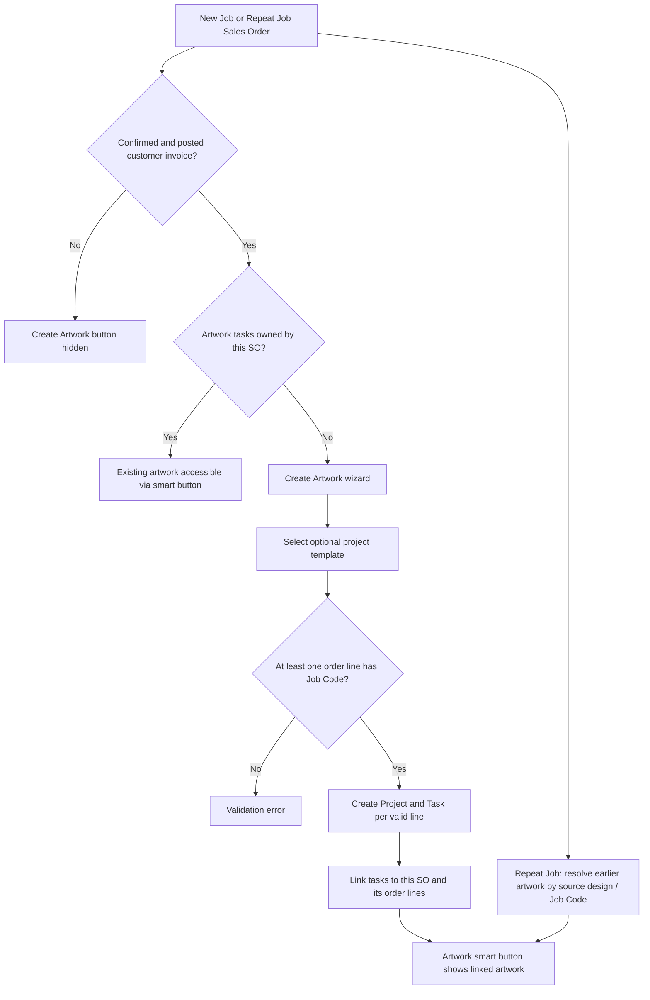

# Artwork Project Flow — Odoo 19

| Metadata | Value |
| --- | --- |
| Module | Artwork Project Flow |
| Technical name | `artwork_project` |
| Odoo version | 19 |
| Manifest version | `19.0.0.1` (unchanged) |
| Author | `Softeko_Lamia` |
| Category | Sales/Project |
| License | LGPL-3 |
| Documentation updated | **2026-11-05** |
| Latest verified release date | Not verified |
| Verification | Source-reviewed and static checks; **not live-tested in Odoo** |

An extension to Sales and Project that creates artwork projects and job-code tasks from confirmed Sales Orders. It supports **New Job and Repeat Job artwork creation** and also links a Repeat Job to artwork from a previous design / Sales Order.

## Contents

- [Overview](#overview)
- [Features](#features)
- [Architecture](#architecture)
- [Workflow](#workflow)
- [Conditions and validations](#conditions-and-validations)
- [Configuration](#configuration)
- [Synchronization and traceability](#synchronization-and-traceability)
- [Security](#security)
- [Technical reference](#technical-reference)
- [Installation and upgrade](#installation-and-upgrade)
- [Proposed test cases](#proposed-test-cases)
- [Troubleshooting](#troubleshooting)
- [Changelog](#changelog)

## Overview

Sales users can initiate artwork creation for an eligible confirmed Sales Order using **Create Artwork**. The button is available to both New and Repeat Jobs, after a customer invoice is posted, provided that **the current Sales Order has not already created its own artwork tasks**. Repeat Jobs can still show artwork linked to an earlier Sales Order in their **Artwork** smart button; that link does **not** prevent creation of new artwork for the repeat order.

Each eligible Sale Order line with a Job Code creates a separate Project and Task. Existing Project and Task records are preserved; existing work is never overwritten merely because a Job Code is reused.

## Features

| Feature | Access / event | Implementation | Behavior |
| --- | --- | --- | --- |
| Create Artwork for New or Repeat Jobs | Sales Order header | `models/sale_order.py`, `views/sale_order_views.xml` | Opens a creation wizard when the SO is confirmed, a customer invoice is posted, and the SO has no *own* artwork tasks. |
| Optional project template | Create Artwork wizard | `wizard/artwork_project_wizard.py` | Copies the selected template's project configuration; removes copied template tasks before making one artwork task per line. |
| Artwork Project and Task generation | Wizard **Create Projects** | `wizard/artwork_project_wizard.py` | Generates one Project/Task per non-display SO line with a nonempty Job Code. Task links to the originating Sale Order Line and Sale Order. |
| Duplicate protection | Create action / wizard | `models/sale_order.py`, `wizard/artwork_project_wizard.py` | Existing artwork owned by this specific SO is opened or prevents further creation. Existing *previous* artwork does not block a repeat order. |
| Artwork smart button | Sales Order button box | `models/sale_order.py`, `views/sale_order_views.xml` | Shows artwork for the current SO plus qualifying earlier artwork found through a repeated requirement design / Job Code. Repeat SO can display `Artwork 0` when no earlier artwork exists. |
| Artwork task's latest SO | Task form and kanban | `models/project_task.py`, `views/project_task_views.xml`, `views/project_task_kanban_views.xml` | Display-only reference to the latest matching confirmed Repeat Job SO; original ownership stays unchanged. |
| Job Code / GDN links | Task **Artwork** tab | `models/project_task.py`, `views/project_task_views.xml` | HTML links built using the originating SO line's Job Code and GDN reference where available. |
| Project's SO reference | Project kanban | `models/project_project.py`, `views/project_kanban_views.xml` | Related name of its linked Sales Order. |

## Architecture

**Dependencies:** `sale_management`, `project`, `crm_requirement_form` as declared in `__manifest__.py`.

```text
artwork_project/
├── __init__.py
├── __manifest__.py
├── models/
│   ├── __init__.py
│   ├── sale_order.py
│   ├── project_project.py
│   └── project_task.py
├── wizard/
│   ├── __init__.py
│   ├── artwork_project_wizard.py
│   └── artwork_project_wizard_views.xml
├── views/
│   ├── sale_order_views.xml
│   ├── project_task_views.xml
│   ├── project_task_kanban_views.xml
│   └── project_kanban_views.xml
├── security/
│   └── ir.model.access.csv
├── README.md
└── CHANGELOG.md
```

The module inherits `sale.order`, `project.project`, and `project.task`, and defines transient model `artwork.project.create.wizard`. It introduces no scheduled actions, controllers, SQL views, or QWeb reports of its own in the supplied source.

## Workflow



For repeat jobs, the earlier artwork may be visible **before** new artwork is created. The Create Artwork button uses **ownership by the current SO**, not the sum of original and previously linked artwork, to decide whether this repeat SO can create its own artwork.

## Conditions and validations

| Area | Trigger | Condition / behavior | Type | Reference |
| --- | --- | --- | --- | --- |
| Create Artwork button | Form render | SO state `sale`, at least one posted `out_invoice`, and no task in `artwork_task_ids` | UI based on computed field | `_compute_can_create_artwork` |
| Backend creation action | Header button | SO state must be `sale` | Python validation | `action_create_artwork` |
| Backend creation action | Header button | At least one non-display SO line with a Job Code | Python validation | `action_create_artwork` |
| Creation wizard | Create Projects | SO state must be `sale` | Python validation | `action_create_project` |
| Creation wizard | Create Projects | At least one non-display line has a Job Code | Python validation | `action_create_project` |
| Creation wizard | Create Projects | No artwork task is already owned by this SO | Python validation | `action_create_project` |
| Repeat Job | Form and wizard | **No Repeat Job exclusion** from artwork creation | Enabled behavior | `sale_order.py`, `artwork_project_wizard.py` |
| Existing linked artwork | Repeat Job smart button | Previous task references can be included by source specification or Job Code; company used for fallback | Python lookup | `_get_artwork_tasks_by_order` |
| Artwork smart button | Repeat Job | Visible even when count is zero; clicking with no artwork raises an explanatory error | UI + Python | `sale_order_views.xml`, `action_open_artwork` |
| Posted invoice | Wizard/back-end direct call | Posted-invoice check currently gates the form button; it is **not separately rechecked** by the two creation methods | UI-only condition | `_compute_can_create_artwork` |

**Important:** The module does not introduce a restriction against Repeat Jobs in the create action or creation wizard. The duplicate check remains per originating Sales Order, not per Job Code across all orders.

## Configuration

- **Project template:** Optional field `project_template_id` on `artwork.project.create.wizard`, with the choices from computed `available_template_ids`. If `project.project.is_template` exists, only template projects are listed; if `active` exists, inactive projects are excluded.
- **Default behavior:** Without a template, `project.project.create()` is used directly. With a template, `project.project.copy()` is called and copied example tasks are removed.
- **Job Codes:** Must already exist on the SO lines, typically provided by `crm_requirement_form`. This module does **not** generate Job Codes or GDN numbers.
- **No new settings menu:** The source declares no separate settings model or menu.

## Synchronization and traceability

| Source | Target | Trigger | Direction / characteristics |
| --- | --- | --- | --- |
| `sale.order` | `project.task.artwork_sale_order_id` | Wizard creation | Stored reference to originating SO (ownership). |
| `sale.order.line` | `project.task.artwork_sale_order_line_id` | Wizard creation | Stored reference to the originating order line. |
| `sale.order.line.job_code` | `project.project.name`, `project.task.name` | Wizard creation | Copied string; not a live related field. |
| `sale.order.partner_id` | Project/Task `partner_id` | Wizard creation | Copied partner reference. |
| Project task's SO | `project.project.artwork_sale_order_id` | Stored compute | Takes the first project task with an originating SO reference. |
| Matching confirmed repeat SOs | `project.task.artwork_latest_sale_order_id` | Non-stored compute | Displays latest matching confirmed SO, leaving the task's originating SO unchanged. |
| Previous design / SO line links | Repeat SO `artwork_task_count` and smart button result | Compute / action | Dynamically retrieves earlier linked artwork; no record reassignment. |

When new artwork is created from a Repeat Job, its tasks belong to that Repeat SO; prior artwork tasks continue to belong to the original SO. An individual Job Code can therefore appear on multiple independent artwork Projects/Tasks across New and Repeat SOs.

## Security

`security/ir.model.access.csv` grants internal users (`base.group_user`) read, write, create and delete access to the transient `artwork.project.create.wizard`. The module adds no custom Project/Task ACL or record rules; existing Odoo Sales/Project permissions continue to apply. The views add no group-specific restriction to the Create Artwork button. Existing security/permissions must be evaluated in the target database.

## Technical reference

| Method / field | Model | Purpose |
| --- | --- | --- |
| `can_create_artwork`, `_compute_can_create_artwork` | `sale.order` | Determines creation-button eligibility, based on confirmed state, posted invoice and absence of *own* artwork. |
| `artwork_task_ids` | `sale.order` | One2many of Tasks whose `artwork_sale_order_id` points to this SO. |
| `artwork_task_count`, `_compute_artwork_task_count` | `sale.order` | Count including accessible earlier artwork for Repeat Jobs. |
| `_get_artwork_tasks_by_order` | `sale.order` | Resolves previous artwork through source-specification ancestors, source lines, or Job Code fallback. |
| `action_create_artwork` | `sale.order` | Validates state/Job Code and opens wizard; otherwise opens already-owned artwork. |
| `action_open_artwork` | `sale.order` | Opens relevant Project form/list. |
| `action_create_project` | `artwork.project.create.wizard` | Creates Project/Task pairs and prevents duplicate creation per SO. |
| `_compute_artwork_latest_sale_order` | `project.task` | Calculates the latest confirmed repeat SO for task display. |
| `action_open_artwork_sale_order` | `project.task` | Opens the computed latest SO. |
| `_compute_artwork_links` | `project.task` | Builds GDN and Job Code navigation links. |

## Installation and upgrade

1. Back up the database and any existing custom addons.
2. Copy the **entire** `artwork_project/` directory into an Odoo 19 addons path, retaining the directory structure.
3. Ensure the declared dependencies are installed and compatible.
4. Restart the Odoo server/process so updated Python code is loaded.
5. In Apps, update the Apps list if needed and install or **Upgrade** `artwork_project`.
6. Refresh the browser, then test a New Job and a Repeat Job with a posted customer invoice.

The manifest version remains `19.0.0.1` because no version bump was requested. A module upgrade still applies changes to declared XML view records.

## Proposed test cases

**These are suggested manual QA checks, not executed Odoo runtime tests.**

| ID | Scenario | Expected result |
| --- | --- | --- |
| AW-01 | Confirmed New Job with posted customer invoice; no artwork | **Create Artwork** visible; wizard creates one Project/Task per valid Job Code line. |
| AW-02 | Confirmed Repeat Job with posted customer invoice; original artwork exists, no own artwork | Previous artwork smart button remains; **Create Artwork** also visible and creates new, separately owned artwork. |
| AW-03 | Confirmed Repeat Job with posted invoice; no original artwork exists | **Create Artwork** visible, even though smart button may show `Artwork 0`; wizard creates artwork. |
| AW-04 | Repeat Job created new artwork; reopen SO | No duplicate Create Artwork button; smart button opens the linked projects, including newly created artwork. |
| AW-05 | SO not confirmed | **Create Artwork** hidden; direct action/wizard rejects creation. |
| AW-06 | Confirmed SO without posted customer invoice | **Create Artwork** hidden. |
| AW-07 | Confirmed SO with no order line Job Code | Backend action/wizard raises a validation error. |
| AW-08 | Call wizard again after artwork already owned by same SO | Duplicate creation blocked. |
| AW-09 | Repeat-of-Repeat Job with original artwork | Earlier artwork can still be found through source chain or fallback. |
| AW-10 | Template selected | Template configuration copied; sample tasks removed; new tasks linked to the current SO. |
| AW-11 | Latest confirmed Repeat SO exists for an original task | Task view opens the latest matching confirmed SO; ownership is not overwritten. |

## Troubleshooting

- **Create Artwork not visible on a Repeat Job:** Verify the SO is confirmed, a posted `out_invoice` exists, and the SO does not already own artwork tasks. The linked-artwork smart button count does not block creation.
- **Artwork 0 on Repeat Job:** The previous source specification / Job Code lookup did not find a matching original task. The current Repeat SO may still create artwork if it meets the creation conditions.
- **Wizard blocks with no Job Code:** Check sale lines' `job_code` values from the CRM Requirement Form flow.
- **Wizard reports artwork already exists:** The current SO already owns at least one artwork task; this is deliberate duplicate prevention.
- **XML upgrade failure:** Restart Odoo after installing Python changes and confirm `crm_requirement_form` is present. Inspect the server's complete trace for the failing field or XPath.

**Developer starting points:** Review `models/sale_order.py` first for button eligibility/linked-artwork lookup, then `wizard/artwork_project_wizard.py` for project creation, and `models/project_task.py` for latest-SO and source links.

## Changelog

See [CHANGELOG.md](CHANGELOG.md) for the dated change record and verified current-feature baseline.
