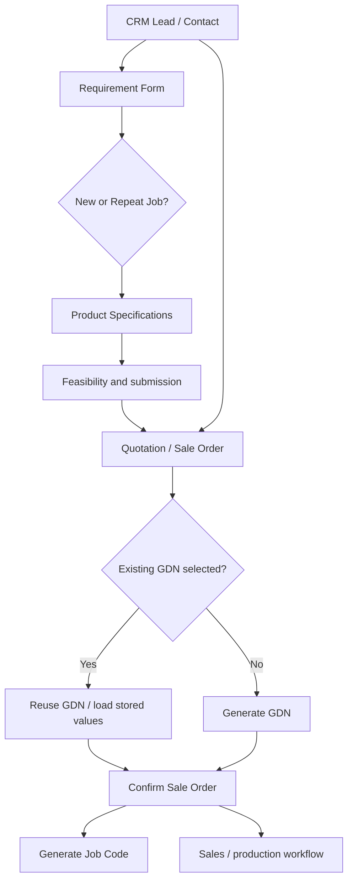

# CRM Requirement Form — Odoo 19

| Information | Value |
| --- | --- |
| Module Name | CRM Requirement Form |
| Technical Name | `crm_requirement_form` |
| Odoo Version | 19 (per manifest version) |
| Module Version | `19.0.0.0` (actual `__manifest__.py`) |
| Author | `Softeko_Lamia` |
| Category | CRM |
| License | LGPL-3 |
| Documentation Updated | 2026-10-26 |
| Latest Verified Release | Not verified — the ZIP contains historical upgrade notes, but no verified release date |
| Documentation Status | Source-code reviewed; **not** runtime-tested on an Odoo instance |

> **Documentation maintenance:** Every future update to this module should update this `README.md` and `CHANGELOG.md` with the **actual changes**, related source files, verified implementation details, the documentation date, and any relevant manual tests. Do not alter existing behavior merely to update documentation.

## Navigation

- [Overview](#overview)
- [Features](#features)
- [Architecture](#architecture)
- [Workflow](#workflow)
- [Conditions and validations](#conditions-and-validations)
- [Configuration](#configuration)
- [Customer ranking](#customer-ranking)
- [Summaries and dashboards](#summaries-and-dashboards)
- [GDN Configuration](#gdn-configuration)
- [Job Code Configuration](#job-code-configuration)
- [Data synchronization](#data-synchronization)
- [Security](#security)
- [Installation and upgrade](#installation-and-upgrade)
- [Proposed manual tests](#proposed-manual-tests)
- [Troubleshooting](#troubleshooting)
- [New developer quick start](#new-developer-quick-start)
- [Update record](#update-record)

## Overview

This Odoo 19 module extends CRM, Contacts, Requirement Forms, Sales, Products, Purchase, and Inventory to capture customer requirements, define finished-good designs (including bags and rolls), generate or reuse Graphic Design Numbers (GDNs), link confirmed Sale Order Lines to Job Codes, and retain references to related design and production documents.

Core dependencies from `__manifest__.py`: `crm`, `sale_crm`, `website`, `mail`, `product`, `uom`, `account`, `stock`, `purchase`.

Users commonly work from **Requirement Forms** to submit design/product specifications, then review linked quotations and GDNs. Alternatively, a Sale Order can be prepared directly and an existing customer GDN selected. Configuration menus supply FG Types, Print Types, Print and Finish, Features, and production processes.

## Features

| Area | User-facing capability | Source |
| --- | --- | --- |
| CRM lead/opportunity | Customer code and customer details, linked Requirement Forms, requirement summaries, ranking access | `models/crm_lead.py`, `views/crm_lead_views.xml` |
| Contacts | Customer code, synchronized WhatsApp/short name/VAT data, related Requirements and ratings | `models/res_partner.py`, `views/res_partner_views.xml` |
| Requirement Form | Customer details, New Job / Repeat Job, specifications, feasibility, submission, document attachments, quotation creation, public submission flow | `models/requirement_form.py`, `models/product_specification.py`, `controllers/main.py`, `views/requirement_form_views.xml` |
| Product Specifications | FG Type, product/dimensions, quantity, color reference, print and finish, layers, roll dimensions and document lines (Print Type/No of Colors no longer appear here) | `models/product_specification.py`, `views/requirement_form_views.xml` |
| Sales | Optional Requirement Form relation, GDN selection/generation, GDN link, Job Code link, summary fields | `models/sale_order.py`, `views/sale_order_views.xml`, `static/src/js/gdn_link_many2one.js` |
| GDN Configuration | Source traceability, product/design details, **Dimensions** tab (renamed from Quantity & Dimensions), design information including editable alphanumeric Print Direction, conditional Roll Details, documents and numeric layer thickness | `models/sale_order.py`, `views/gdn_configuration_views.xml` |
| Job Code Configuration | SQL-view-based job reference per Sale Order Line, GDN-sourced Color Details / Print Type, **Bag-only Pouch Details** (read-only Bag Length/Width and editable Side/Bottom Gusset), editable production parameters, Roll-only read-only Roll Details, and **Quality Department → Quality Documents** (independent multi-file upload, no Document Type or REQ/GDN import); One Repeat Size uses separate storage | `models/job_code_configuration.py`, `models/sale_order.py`, `views/gdn_configuration_views.xml` |
| Customer Ranking | Questionnaire scores, automatic/customer-average ranking, manual ranking field | `models/customer_rating.py`, `views/customer_rating_views.xml` |
| Product setup | Finished-good types, layer thickness, category type, FG-specific product settings | `models/product_extension.py`, `views/product_template_views.xml` |
| Purchase / Inventory | Raw-material Item Code handling on Purchase Order confirmation and Item Code history in Inventory Configuration | `models/purchase_order.py`, `views/purchase_item_code_views.xml` |
| Documents | Sales document synchronization and named product/GDN document groups | `models/documents_sales_sync.py`, `data/documents_sales_sync.xml` |
| Website | Customer-facing requirement form display and submission with token routes | `controllers/main.py`, `views/website_templates.xml` |

These are **source-code-verified features**; this documentation does not imply that all flows have been tested against a live database.


### Requirement Document Types configuration and inline upload (2026-10-18)

**Access:** Requirement Forms → Requirement Configuration → **Document Types** (Sales Manager permission to maintain the master list). Six initial choices are provided: **Raw File**, **Customer Approved File**, **Digital Print File**, **Production Layout**, **Plate Layout** and **Color Separation**. Administrators/Sales Managers can create, rename, archive, or reorder types in this menu; existing custom labels are linked on upgrade so attachments are retained.

**Requirement Form:** Product Specifications → Design Documents: **Add a line** creates an inline-editable row, not a **Create Design Documents** popup. Select a configured **Document Type** and upload multiple files in its **Documents** cell. New types must be created in the Configuration menu, not from the dropdown.

**GDN:** GDN Documents uses **Add a line** to select a configured Document Type and upload multiple files; a new GDN no longer starts with six empty category rows (changed 2026-10-20). The six **Document Types master choices remain available in the dropdown**, but they are not automatically inserted as empty GDN document lines. Existing Requirement Form document lines and actual files still synchronize to linked GDNs, including legacy categorized uploads; no uploaded files are deleted. On module upgrade `data/gdn_document_line_migration.xml` calls `_bootstrap_existing_gdn_document_lines()`, which removes only **empty, non-source-linked fixed-category placeholder rows** left by the old behavior. Saved GDN document rows with uploaded files and custom categories are retained. The historical `document_type` text values and file relationships remain, and `data/requirement_document_type_migration.xml` continues to backfill the configured type links.

**Technical reference:** `models/requirement_document_type.py`, `models/design_document_line.py`, `models/gdn_document_line.py`, `views/requirement_form_views.xml`, `views/gdn_configuration_views.xml`, `views/requirement_option_views.xml`, `data/requirement_document_type_data.xml`, `data/requirement_document_type_migration.xml`, `security/ir.model.access.csv`.

**Proposed QA (not executed):** Verify GDN has no empty prefilled Document Type rows; verify inline Add a line with multiple attachments on a new/existing REQ design; verify every document type can be selected on GDN; add a new type in Configuration and use it in both lists; upgrade an old record and confirm old files remain; rename a configured type and check the existing documents/GDN synchronization; confirm users without Sales Manager rights can select but cannot maintain the master list.

## Architecture

```text
crm_requirement_form/
├── __manifest__.py               # dependencies, assets, data/views
├── __init__.py
├── models/
│   ├── crm_lead.py, res_partner.py, customer_rating.py
│   ├── requirement_form.py, product_specification.py
│   ├── design_document_line.py, gdn_document_line.py
│   ├── sale_order.py, job_code_configuration.py
│   ├── product_extension.py, purchase_order.py, stock_lot.py
│   └── job_production_process.py, documents_sales_sync.py
├── controllers/main.py
├── views/                      # CRM, REQ, Sales, GDN, Job Code, inventory, website
├── data/                       # configurations, sequences, scheduled document sync
│   └── gdn_document_line_migration.xml  # backfill existing GDN document rows
├── security/ir.model.access.csv
├── static/src/js/              # OWL list widget and custom layer control
├── static/src/scss/            # backend styles
├── static/src/xml/             # front-end templates
├── migrations/19.0.0.1/, migrations/19.0.0.2/
├── UPGRADE_NOTE*.txt, WHATSAPP_*.txt
├── README.md                   # this file
└── CHANGELOG.md                # verified update notes and historical evidence
```

### Important models

| Odoo model | What it represents | Code |
| --- | --- | --- |
| `crm.requirement.form` | Requirement master, feasibility/job-type and customer workflow | `models/requirement_form.py` |
| `crm.requirement.specification` | Individual design/product specification, including up to 10 layers | `models/product_specification.py` |
| `crm.requirement.fg.type` | Finished-good type configuration | `models/product_specification.py` |
| `crm.requirement.print.type.option` | Configurable Print Type values | `models/product_specification.py` |
| `crm.requirement.print.finish.option` | Print/finish choices | `models/product_specification.py` |
| `crm.requirement.feature.option` | Design feature choices | `models/product_specification.py` |
| `crm.requirement.bag.type.option` | Bag-type configuration model | `models/product_specification.py` |
| `sale.gdn.configuration` | Generated/sourced GDN record, manual Print Type / No of Colors, GDN-owned document lines | `models/sale_order.py` |
| `sale.gdn.document.line` | Editable GDN document type with multiple files and source-file provenance | `models/gdn_document_line.py` |
| `crm.requirement.design.document.line` | REQ design's editable document rows synchronized into associated GDN lines | `models/design_document_line.py` |
| `sale.job.code.configuration` | SQL view keyed to Sale Order Line records | `models/job_code_configuration.py` |
| `crm.customer.rating` | Customer scoring and ranking | `models/customer_rating.py` |
| `product.category.type` | Inventory category-type configuration | `models/product_extension.py` |
| `purchase.item.code` | Stored Item Code history | `models/purchase_order.py` |
| `crm.job.production.process` | Production-process choices/ordering | `models/job_production_process.py` |

### Entry points

- **Requirement Forms → Requirement Forms**: create/view the Requirement Form.
- **Requirement Forms → Requirement Configuration**: FG Types, Print and Finish, Print Types, Features, Process Sequence and Type of Category (as installed by the views).
- **Sales → Configuration → GDN Configurations**: inspect the GDN's linked design information and documents.
- **Sales → Configuration → Job Code Configurations**: view linked production references.
- **Inventory → Configuration → Item Codes**: browse Item Code history.

The precise visual position of menus may vary if other inherited views or Odoo Studio customizations are installed.

## Workflow



**Direct Sale Order flow:** choose customer, choose an eligible existing GDN or generate a new GDN for the line, then confirm. In the code, `action_confirm()` checks that product lines have GDNs and then generates missing Job Codes after confirmation.

**Repeat Job:** Requirement Form repeat-specification helpers and GDN reuse checks are implemented, but must be tested using both a matching and a mismatched source design before deploying changes to repeat flows.

## Conditions and validations

| Trigger | Verified condition / behavior | Implementation |
| --- | --- | --- |
| Confirm Sale Order | Every non-display product line must have `gdn_configuration_id` or `gdn_number`; otherwise a `UserError` blocks confirmation | `sale.order._check_gdn_generated_before_confirm()`, `action_confirm()` |
| Generate GDN | Supported states are `draft`, `sent`, `sale`; existing GDN prevents duplicate assignment | `sale.order.line.action_generate_gdn()` |
| Generate GDN | Requires Customer Code, a configured FG product/code and GDN Job Number sequence | `sale.order.line.action_generate_gdn()` |
| Select GDN | Dropdown domain includes the sale customer's GDNs and the currently selected GDN | `views/sale_order_views.xml` |
| Selected GDN after confirmation | Linked number shown as a clickable link for `sale`, `done`, `cancel` with selected record; no selected GDN means no link | `static/src/js/gdn_link_many2one.js` |
| Reused GDN | Existing GDN loads a saved specification snapshot and locks selected technical/commercial fields; price remains editable in the view | `sale.order.line._apply_gdn_configuration()` and `views/sale_order_views.xml` |
| GDN record fields | Many GDN source attributes are read-only; `print_type_id` and `no_of_colors` are independent editable GDN fields; design notes remain editable related fields | `models/sale_order.py` |
| Roll Details tab | Hidden if `fg_type != 'roll'` | `views/gdn_configuration_views.xml` |
| Roll-specific dimension fields | `coil_width_mm` and `cutoff_length_mm` are shown in **Dimensions** only when `fg_type == 'roll'` | `views/gdn_configuration_views.xml` |
| Bag-specific dimension fields | `length`, `width`, and `gusset` appear in **Dimensions** for Bag and are hidden for Roll | `views/gdn_configuration_views.xml` |
| Job Code Pouch Details visibility | Tab `job_pouch_details_tab` is displayed only for `fg_type == 'bag'`; Bag Length/Width are read-only, while Side/Bottom Gusset are manual inputs | `views/gdn_configuration_views.xml`, `models/job_code_configuration.py` |
| Job Code manual Gusset write | Only approved manual production fields can be written through the SQL-view model; `job_pouch_side_gusset` and `job_pouch_bottom_gusset` are saved on `source_line_id` (`sale.order.line`) via `write()` | `models/job_code_configuration.py`, `models/sale_order.py` |
| Customer ranking | Ranking calculations and source guards are defined in `crm.customer.rating`; refer to source before changing the rating scale | `models/customer_rating.py` |
| Public Requirement Form | Token-gated public routes and a submitted-data processing path exist; inspect controller logic and access controls before exposure changes | `controllers/main.py` |

The above distinguishes Python-level checks from view-only visibility/readonly rules. Client-side visibility is **not** a security boundary.

## Configuration

| Menu | Model | Fields and purpose | Available values / behavior |
| --- | --- | --- | --- |
| Requirement Configuration → FG Types | `crm.requirement.fg.type` | `name`, `code`, `behavior`, `sequence`, `active` | Loaded via `data/fg_type_data.xml` and view setup |
| Requirement Configuration → Print and Finish | `crm.requirement.print.finish.option` | `name`, `code`, `sequence`, `active` | Configurable choices |
| Requirement Configuration → Print Types | `crm.requirement.print.type.option` | `name`, `code`, `sequence`, `active` | **Surface**, **Reverse**, seeded in `data/requirement_options_data.xml` |
| Requirement Configuration → Features | `crm.requirement.feature.option` | `name`, `code`, `sequence`, `active` | Configurable choices |
| Requirement Configuration → Process Sequence | `crm.job.production.process` | `name`, `sequence` | Uses `data/job_production_process.xml` |
| Requirement Configuration → Type of Category | `product.category.type` | `name`, `category_initial`, `sequence`, `active` | Managed with inventory/category access controls |
| Product settings | `product.template` | `requirement_fg_type_id`, `requirement_fg_type`, `thickness_microns`, product/category flags | Used in FG filtering and layer thickness sourcing |

### Design Information: Print Type and No of Colors (GDN-only entry)

- **Requirement Form → Product Specifications** no longer shows Print Type or No of Colors. Historical `crm.requirement.specification.print_type_id` and `.no_of_colors` columns remain for backward compatibility only.
- **GDN Configuration → Design Information** contains directly editable, **stored-on-GDN** `print_type_id` (`Many2one` to `crm.requirement.print.type.option`) and `no_of_colors` (`Integer`). Values entered here are **not written back** to the Requirement Form or Sale Order Line.
- Print Type choices (including configured Surface and Reverse defaults) remain managed in **Requirement Configuration → Print Types**. On upgrade, historical GDN values are backfilled from the old linked Sale Order Line once, if present; subsequent input is manual, independent GDN data.
- `roll_type` stays on the GDN model but remains hidden from the GDN Product Summary.

## Customer ranking

`crm.customer.rating` relates a lead/customer and records multiple questionnaire fields: `responsiveness_score`, `behavior_score`, `payment_on_time_score`, `meeting_adherence_score`, `requirements_artwork_score`. It defines `auto_rank`, `customer_average_rank`, `manual_rank`, and effective `rank` as computed/selection fields. Relevant methods include `_get_question_ranks()`, `_get_form_average_rank()`, `_compute_auto_rank()`, `_compute_customer_average_rank()` and `_compute_rank()`.

**Not verified at runtime:** actual scoring distribution and results on a production dataset. The exact weight and override behavior should be read from `models/customer_rating.py` before changing ranking policy.

## Summaries and dashboards

- The CRM lead has a `requirement_summary_html` field and `_refresh_requirement_summary()` for its requirements view (`models/crm_lead.py`). Historical notes describe both card-based and manual summary variants; **current view/code must be taken as authoritative**.
- Requirement Form has counts/links for Quotations, GDNs, Job Codes, and Customer Ranking (`models/requirement_form.py`).
- Sale Orders include `job_code_summary` and `gdn_number_summary` for list-level references, implemented through `sale.order._compute_line_reference_summaries()` (`models/sale_order.py`).

## GDN Configuration

`Sale GDN Configuration` (`sale.gdn.configuration`) is created by `sale.order.line.action_generate_gdn()`. Source links include `partner_id`, `source_order_id`, `source_line_id` and related `requirement_form_id`; the `gdn_number` is a stored name and the record carries a JSON `snapshot`. In the **Source & Traceability** card, the form displays Customer (`partner_id`), Source Sale Order (`source_order_id`) and REQ ID (`requirement_form_id`), but **does not display Source Sale Order Line (`source_line_id`)**. Only its form-view row was removed; the underlying source-line relation, synchronization logic and optional GDN list column remain intact (`views/gdn_configuration_views.xml`, record `sale_gdn_configuration_form_view`).

### Tabs

| GDN tab | Fields and behavior |
| --- | --- |
| Dimensions | Renamed from **Quantity & Dimensions** in the GDN tab and its section heading; tab internal name `gdn_quantity_dimensions_tab` is retained. Shows Total Thickness for all FG Types; **Length (mm)**, **Width (mm)** and **Gusset (mm)** for Bag, and **Coil Width (mm)** plus **Cutoff Length (mm)** for Roll. **Quantity** and **Quantity UOM** remain absent from the GDN form display; underlying fields and list columns were not removed. |
| Design Information | Color Reference, Color Reference Type, **GDN-only editable Print Type and No of Colors**, Print Direction, weight, features |
| Roll Details | Seven remaining linked roll attributes (Final Roll Direction, Weight, OD, Meters, Core ID, Core Thickness, Core Type); visible when FG Type is Roll |
| GDN Documents | **Editable Add a line** and configured Document Type dropdown, multiple files per row; no six empty prefilled rows. Existing Requirement Form documents and legacy attachments remain synchronized/accessible; upgrade removes unused empty legacy placeholders only |
| Layers / Material Structure | Layer 1–10 product fields and **numeric Thickness (Microns)** fields, shown only for populated layers |

### Roll-specific field map

For a Roll product, values are exposed by related fields from `sale.order.line`. **Coil Width (mm)** and **Cutoff Length (mm)** are displayed under **GDN → Dimensions** (formerly **Quantity & Dimensions**), while the other seven fields remain in **GDN → Roll Details**:

| Requirement Specification | Sale Order Line | GDN |
| --- | --- | --- |
| `coil_width_mm` | `req_coil_width_mm` | `coil_width_mm` |
| `cutoff_length_mm` | `req_cutoff_length_mm` | `cutoff_length_mm` |
| `final_roll_direction` | `req_final_roll_direction` | `final_roll_direction` |
| `final_roll_weight_kg` | `req_final_roll_weight_kg` | `final_roll_weight_kg` |
| `final_roll_od_mm` | `req_final_roll_od_mm` | `final_roll_od_mm` |
| `final_roll_meters` | `req_final_roll_meters` | `final_roll_meters` |
| `core_id_mm` | `req_core_id_mm` | `core_id_mm` |
| `core_thickness_mm` | `req_core_thickness_mm` | `core_thickness_mm` |
| `core_type` | `req_core_type` | `core_type` |

### Layer thickness map

For each layer `N` from **1 to 10**:

- **REQ Product Specification:** `crm.requirement.specification.layer_N_thickness` (`Float`, micron value).
- **GDN:** `sale.gdn.configuration.layer_N_thickness` is a related field using `source_line_id.requirement_specification_id.layer_N_thickness`.
- **GDN view:** `views/gdn_configuration_views.xml` shows `layer_N_product_tmpl_id` alongside `layer_N_thickness`. It does **not** show `layer_N_variant_id` as the numeric thickness.

Example: if REQ layer thicknesses are `7.00` and `38.00`, the matching linked GDN shows `7.00` and `38.00` microns. For a GDN without a linked Requirement Specification, these related fields can be empty; **do not claim fallback behavior unless it is implemented**.

## Job Code Configuration

`sale.job.code.configuration` is defined as `_auto = False` (SQL view) over line-level production data. It is displayed under **Sales → Configuration → Job Code Configurations** and has links to Customer, Sale Order, Requirement Form, GDN and Product. The Sale Order Line stores job production parameters (process sequence, one-up dimensions, repeats, printing/film parameters and pouch gussets). The corresponding Job Code view exposes them and includes a controlled `write()` implementation. In the form's **Product Summary**, the redundant **Sale Product** (`product_id`) row is removed; the separate **Product** (`bag_type_product_tmpl_id`) row remains. The `product_id` model field and Job Code list-view product column are not removed.

Generation: `sale.order.action_confirm()` calls `_generate_missing_job_codes()` after `super().action_confirm()`. The Sale Order Line `job_code_link` HTML field provides a record link in the order lines.

### Job Code → Measuring Unit (2026-10-19)

On **Sales → Configuration → Job Code Configurations → Production Process**, the
**Measuring Unit** dropdown appears immediately **above Process Sequence**.
It is `job_measuring_unit_id` (`Many2one('uom.uom')`) and lists existing units
maintained under **Inventory → Configuration → Units & Packagings** (e.g.,
`kg`, `PCs`, `Linear Meters`). The dropdown does not create new units; maintain
units in Odoo's standard UoM configuration. This is a **manual, optional**
job-specific input and does not automatically copy or override Quantity UOM.
It is visible for Bag/Pouch and Roll jobs.

**Persistence:** `sale.job.code.configuration` is a SQL-view model. Its
`write()` saves the selected UoM to
`sale.job.code.repeat.size.measuring_unit_id`, keyed by `source_line_id`, the
same supporting table that stores One Repeat Size. The SQL view exposes the
choice using `repeat_cfg.measuring_unit_id AS job_measuring_unit_id`. No
`sale_order_line.job_measuring_unit_id` column is introduced. Existing process
sequence, repeat-size storage, and other Job Code fields are unchanged.

**Deployment:** Restart/deploy new Python code and **upgrade**
`crm_requirement_form` so Odoo adds the supporting table's `measuring_unit_id`
column and recreates the Job Code SQL view. Restarting alone is insufficient.

**Proposed manual tests (not run):** Verify dropdown lists `kg`, `PCs`, and
`Linear Meters` when configured; save a choice and reopen the Job Code; change
and clear the choice; confirm One Repeat Size remains unchanged; confirm the
standard Sales Order Quantity UOM is unaffected. Check Roll and Bag Job Codes.

### Job Code → GDN Color Details and Print Type (2026-10-19)

The **Product Summary** on the Job Code Configuration form displays two additional,
**read-only**, GDN-sourced fields. Both appear for **Bag/Pouch and Roll** jobs,
without an FG Type visibility condition:

| Job Code field | GDN source field | Type / behavior |
| --- | --- | --- |
| `gdn_color_details` — **Color Details** | `gdn_configuration_id.no_of_colors` | Integer: the GDN's existing **No of Colors** count |
| `gdn_print_type_id` — **Print Type** | `gdn_configuration_id.print_type_id` | Many2one: the selected configured print type (e.g. Surface / Reverse) |

They are non-stored (`store=False`) related fields on the SQL-view-backed
`sale.job.code.configuration` model. They read the **linked GDN**, not the old
Requirement Form fields and do not need any new SQL-view columns. Updates made
on the GDN are reflected when the Job Code record is read/refreshed. If a Job
Code has no linked GDN or no entered value, the field is empty (an unset color
count may display as zero). Editing remains on the GDN only; existing job
production fields, GDN Design Information and Roll Details are unchanged.

**Proposed verification (not runtime-tested):** set GDN Print Type and No of
Colors, then open linked Bag and Roll Job Codes. Check both values, edit the
GDN and refresh Job Code to see the new values; verify no Job Code write action
is needed and no `UndefinedColumn` SQL-view error is introduced.

### Job Code → Bag-only Pouch Details (2026-10-19)

**Access:** Sales → Configuration → Job Code Configurations → open a Job Code with **FG Type = Bag** → **Pouch Details**. The tab is `name="job_pouch_details_tab"` with the Odoo 19 expression `invisible="fg_type != 'bag'"`; it is **not shown for Roll** (`fg_type == 'roll'`). The existing **Roll Details** tab remains Roll-only. The `Pouch Details` section contains exactly four fields:

| Visible field | `sale.job.code.configuration` field / type | Source and persistence | Editable in Job Code |
| --- | --- | --- | --- |
| **Bag Length (mm)** | `length` (`Float`) | Existing SQL-view projection of `sale.order.line.req_length` | **No** — `readonly=True` and view `readonly="1"` |
| **Bag Width (mm)** | `width` (`Integer`) | Existing SQL-view projection of `sale.order.line.req_width` | **No** — `readonly=True` and view `readonly="1"` |
| **Side Gusset (mm)** | `job_pouch_side_gusset` (`Float`) | **New** `sale.order.line.job_pouch_side_gusset` (`copy=False`), projected by the Job Code SQL view | **Yes** — manual entry |
| **Bottom Gusset (mm)** | `job_pouch_bottom_gusset` (`Float`) | **New** `sale.order.line.job_pouch_bottom_gusset` (`copy=False`), projected by the Job Code SQL view | **Yes** — manual entry |

**Data flow:** `sale.job.code.configuration` is `_auto = False`, so it has no independent writable SQL table. In `models/job_code_configuration.py`, the SQL view `init()` SELECT includes `sol.req_length AS length`, `sol.req_width AS width`, and the two new `sol.job_pouch_*` columns. Its existing `write()` approved-field set now includes both new gussets; it forwards them to `record.source_line_id.write(line_vals)` so the **Sale Order Line** stores the values. After saving/reopening the Job Code, the SQL view reads the saved Sale Order Line values. No new relation to `sale.job.code.repeat.size`, calculation, GDN gusset mapping or automatic side/bottom-gusset synchronization was added. The pre-existing GDN **Gusset (mm)** field (`gusset`) is separate and unchanged.

**Product Summary cleanup:** The Job Code **form** removes only `<field name="product_id" string="Sale Product"/>` from **Product Summary**. The existing `bag_type_product_tmpl_id` **Product**, design information, source links, Job Code SQL column `product_id`, and list view are unchanged.

**Code references:** `models/sale_order.py` (`sale.order.line`, two new `fields.Float` attributes), `models/job_code_configuration.py` (`sale.job.code.configuration`, its `write()` and SQL `init()` projection), and `views/gdn_configuration_views.xml` (Product Summary and Pouch Details tab).

**Deployment:** Restart/deploy updated Python code and **upgrade** `crm_requirement_form` in Odoo 19. The upgrade adds the two `sale_order_line` columns, reloads the edited view and refreshes the SQL view to expose the new columns. Do not rely on a browser refresh or a source-file copy alone. Back up the database before upgrading.

**Proposed staging tests (not executed):** Open Bag and Roll Job Codes to check visibility; compare Bag Length/Width to the source Sale Order Line and verify they cannot be edited; save Side/Bottom Gusset, reopen and compare persisted values; verify the legacy GDN Gusset is unchanged; check the Job Code Product Summary has Product but no Sale Product; verify Roll Details and other production inputs still work.

### Job Code → Quality Department → Quality Documents (2026-10-20)

**Access:** Sales → Configuration → Job Code Configurations → Quality Department → **Quality Documents** beneath the unchanged Ink/Adhesive/OPV/Total GSM fields.

**Behavior:** A plain multi-file upload folder (`many2many_binary`) for files associated **only with the currently opened Job Code**. There are **no Document Type fields, category rows, Add a line table, prefilled documents, or Product Specification/GDN/Requirement Form document imports**. New Job Codes start with no Job Code-specific attachments. Uploaded files are linked solely to the corresponding source Sale Order Line; saving/reopening the Job Code loads only files uploaded in this new Job Code folder. Removing a file from this folder unlinks it from the Job Code and does not intentionally modify any other document collection.

**Technical mapping:** The Job Code SQL view (`sale.job.code.configuration`, `_auto=False`) exposes non-stored `job_quality_attachment_ids = fields.Many2many(related='source_line_id.job_quality_attachment_ids', readonly=False)`. The underlying `sale.order.line.job_quality_attachment_ids` is a dedicated Many2many to `ir.attachment` with relation table `sale_order_line_job_quality_attachment_rel` and `copy=False`. The Job Code `write()` allowlist includes this field and forwards the upload commands to `source_line_id.write()`; files are not added to `crm.requirement.design.document.line`, `sale.gdn.document.line`, or any Document Type master. The original GDN ↔ Requirement Form document synchronization is unchanged.

**Legacy compatibility:** Previous releases created `sale.job.code.document.line` records that referenced Product Specification documents. The legacy model/table is retained to preserve existing data, but the Job Code form no longer displays it. Automatic population hooks on order confirmation, Sale Order Line updates and source document create/write are removed; the migration call in `data/job_code_document_migration.xml` is no longer listed in `__manifest__.py` and thus is not run at upgrade. Existing REQ and GDN files remain in their original locations and are **not copied** into the new Job Code folder.

**Files changed:** `models/sale_order.py`, `models/job_code_configuration.py`, `models/design_document_line.py`, `views/gdn_configuration_views.xml` and `__manifest__.py`; updated documentation in `README.md` and `CHANGELOG.md`.

**Deployment:** Backup the database, deploy the module, restart Odoo, upgrade `crm_requirement_form` and refresh the browser to load the new Job Code document field and view.

**Proposed staging QA (not executed):** Open an existing Job Code that formerly showed Product Specification files and verify the new folder starts empty. Upload two files, save, reopen and verify only those files appear. Open a different Job Code and check its folder is separate. Remove one Job Code file and verify GDN/REQ documents are unchanged. Verify there is no Document Type dropdown or Add a line table. Confirm Quality Department GSM fields and all other Job Code tabs work as before, and that new REQ/GDN documents never appear here automatically.

### Job Code → Roll Details

The Job Code Configuration form has a **Roll Details** tab. It is only visible when
`fg_type == 'roll'`; Bag job codes do not show this tab. The tab displays nine
existing **read-only** fields, sourced via `sale.job.code.configuration`'s SQL
view from the linked Sale Order Line:

| Job Code field | Sale Order Line source | Type |
| --- | --- | --- |
| `coil_width_mm` (Coil Width (mm)) | `req_coil_width_mm` | Float |
| `cutoff_length_mm` (Cutoff Length (mm)) | `req_cutoff_length_mm` | Float |
| `final_roll_direction` | `req_final_roll_direction` | Char |
| `final_roll_weight_kg` | `req_final_roll_weight_kg` | Float |
| `final_roll_od_mm` | `req_final_roll_od_mm` | Float |
| `final_roll_meters` | `req_final_roll_meters` | Float |
| `core_id_mm` | `req_core_id_mm` | Float |
| `core_thickness_mm` | `req_core_thickness_mm` | Float |
| `core_type` | `req_core_type` | Char |

The fields and SQL mappings **already existed** in
`models/job_code_configuration.py`; this update adds only their presentation
in `views/gdn_configuration_views.xml`. No new Python fields, database columns,
synchronization methods, or write permissions are introduced. The separate
GDN Roll Details layout and Job Code's manual Production Process fields remain
unchanged. To verify on staging, open a linked Roll Job Code with populated
Requirement Form roll values and compare its nine fields to the originating
Sale Order Line; confirm the new tab is hidden on Bag jobs.

## Data synchronization

| Source | Target | Update path | Key method / field |
| --- | --- | --- | --- |
| REQ Specification | Sale Order Line | Requirement-to-quotation creation/sync | `crm.requirement.form._prepare_sale_order_line_from_specification()`, `_sync_specifications_to_sale_order()` |
| Sale Order Line | Linked REQ Specification | On `sale.order.line.write()` (unless sync-skipping context) | `_prepare_requirement_specification_sync_values()` |
| Sale Order Line | Source GDN | On linked line write, for matching source line | `_prepare_gdn_sync_values()`, `_sync_linked_requirement_and_gdn()` |
| Sale Order Line | Job Code SQL view | SQL view reads line fields, including existing `req_length`/`req_width` and new `job_pouch_side_gusset`/`job_pouch_bottom_gusset` | `sale.job.code.configuration.init()` in `models/job_code_configuration.py` |
| Job Code → Pouch Details manual gussets | Source Sale Order Line | SQL-view `write()` forwards approved manual changes to `source_line_id.write(line_vals)`; read-back is via SQL view | `sale.job.code.configuration.write()`; `sale.order.line.job_pouch_*` |
| REQ design document rows | GDN-owned `gdn_document_line_ids` | Copied at generation / bootstrapped on upgrade; file/type changes synchronized by source-row hooks | `models/design_document_line.py`, `sale.gdn.configuration._sync_document_lines()` |
| Legacy six-category/uncategorized GDN files | Editable GDN document list | Import only categories containing files; module upgrade prunes empty six-category placeholders, without deleting uploaded attachments | `sale.gdn.configuration._bootstrap_existing_gdn_document_lines()` |
| Print Type | GDN directly (manual) | Stored on `sale.gdn.configuration.print_type_id`; no ongoing REQ/Sale Order relation | GDN Design Information |
| No of Colors | GDN directly (manual) | Stored on `sale.gdn.configuration.no_of_colors`; no ongoing REQ/Sale Order relation | GDN Design Information |
| GDN Print Type / Color Details | GDN → Job Code (read-only) | Non-stored related fields on Job Code via `gdn_configuration_id`; FG Type independent | Job Code Product Summary |
| Layer thickness (1–10) | REQ Specification → GDN | Direct related field, through linked SO line specification | `layer_N_thickness` |

**Snapshot vs live:** GDN stores a `snapshot` JSON at generation; many GDN fields are also related to the live source line/specification. The snapshot serves reuse behavior and is not identical to a guarantee of live updates for every field. When altering a field map, check copying, syncing, and related paths separately.

### Confirmed Sale Order: Select GDN link (latest functional change present in this ZIP)

In `views/sale_order_views.xml`, `gdn_configuration_id` uses `widget="gdn_link_many2one"`. The JavaScript widget `static/src/js/gdn_link_many2one.js`:

1. Preserves the original Many2one selection widget while the Sale Order is a quotation (`draft`/`sent`).
2. Renders a clickable link to `/web#id=<GDN ID>&model=sale.gdn.configuration&view_type=form` when a GDN is selected and `gdn_order_state` is `sale`, `done`, or `cancel`.
3. Displays `gdn_number`, otherwise the selected GDN's display name.
4. Leaves the underlying `gdn_configuration_id` field, domain, and readonly condition in the XML intact.

**Scope:** This is an **existing functional change** already present in the supplied ZIP used to generate these documents. Adding this README/CHANGELOG does not modify the widget.

## Security

The supplied ZIP defines ACLs in `security/ir.model.access.csv`. Important verified examples:

| Model | Group | Permissions |
| --- | --- | --- |
| `sale.gdn.configuration` | `sales_team.group_sale_salesman` | Read, write, create; no delete |
| `sale.job.code.configuration` | `sales_team.group_sale_salesman` | Read, write; no create or delete |
| `crm.job.production.process` | `sales_team.group_sale_salesman` | Read, write, create, delete |
| `product.category.type` | `base.group_user` | Read only |
| `product.category.type` | `stock.group_stock_manager` | Read, write, create, delete |
| `purchase.item.code` | `stock.group_stock_manager` | Read only |
| `crm.requirement.form` / `crm.requirement.specification` | No group in the module CSV | Read, write, create, delete via supplied ACL |
| Print Type / Print and Finish / FG/Feature/Bag choices | No group in the module CSV | Read, write, create, delete via supplied ACL |

> **Existing security caveat:** Several ACL entries intentionally have an empty `group_id` in the supplied module; that makes them broad. This documentation did **not** change those ACLs. Review them against your deployment's intended access policy. Website controllers also use public token routes; verify token use and server permissions separately.

## Installation and upgrade

1. Confirm Odoo **19**, compatible add-ons paths, and the manifest dependencies.
2. Back up the database and the deployed `crm_requirement_form` directory.
3. Replace the existing module folder with the complete `crm_requirement_form/` directory from the ZIP. **Keep the folder name unchanged.**
4. Restart the Odoo service to load Python models and the asset manifest.
5. In Apps, update the Apps List if required; then **Upgrade** the `crm_requirement_form` module (or execute Odoo's equivalent upgrade command in your environment).
6. Refresh the browser; if the GDN list widget is stale, rebuild/clear frontend assets through the normal supported Odoo deployment process.
7. Verify user permissions, seeded configuration records, GDN/Job Code views, Repeat Job, and public form routes in a staging database before production rollout. For the 2026-10-20 GDN Documents change, confirm the six empty placeholder rows disappear after **module Upgrade**; the Document Types dropdown and uploaded files still work. **For the 2026-10-19 Pouch Details update**, also verify Odoo has created the two new `sale_order_line` gusset columns and the `sale_job_code_configuration` SQL view can read them without `UndefinedColumn` errors.

**Manifest version note:** The current ZIP's `__manifest__.py` says `19.0.0.0`. Some separately preserved `UPGRADE_NOTE*.txt` files mention historical labels such as `19.0.0.33` through `.36`, but those are **not** proof of the current manifest version or dated releases. This documentation does not rewrite the manifest.

## Proposed manual tests

These are **proposed tests**, not executed tests.

| ID | Preconditions / steps | Expected result |
| --- | --- | --- |
| QA-01 | Open a REQ Product Specification | Print Type and No of Colors are absent from the REQ form; other fields remain |
| QA-02 | On a GDN enter Print Type = Reverse and No of Colors = 4, save and reopen | Both values persist on that GDN and do not change the linked REQ/Sale Order Line |
| QA-02B | In Job Code → Production Process, select Measuring Unit = kg, save/reopen, change to PCs, and clear it; check Repeat Size and Sales Quantity UOM | Dropdown uses `uom.uom`, selected value persists on Job Code, changing it does not alter One Repeat Size or the Sale Order Quantity UOM |
| QA-02A | Open linked Bag/Pouch and Roll Job Codes after GDN Print Type = Reverse and No of Colors = 4; then change GDN values and refresh Job Code | Job Code Product Summary shows GDN Color Details = 4 and Print Type = Reverse, reflecting subsequent GDN edits in both FG Types; fields remain read-only |
| QA-03 | Make Roll design with all nine roll-specific values filled; create GDN | Dimensions shows Coil Width and Cutoff Length; Roll Details shows the other seven values, all read-only |
| QA-04 | Open Bag GDN | Roll Details tab is not visible; Coil Width and Cutoff Length are hidden in Dimensions; Length, Width and Gusset remain visible |
| QA-05 | REQ has layer 1 = 7 and layer 2 = 38 microns; create linked GDN | GDN Layers tab shows numeric 7 and 38, not variant display names |
| QA-06 | Create Sale Order without GDN on a product line; try Confirm | Confirmation is blocked with missing-GDN error |
| QA-07 | In draft quotation, select an existing customer GDN | Select GDN acts as normal dropdown and filters appropriately |
| QA-08 | Confirm Sale Order with a selected GDN, then click Select GDN | The GDN Configuration form opens via clickable link |
| QA-09 | Reuse an existing GDN on a direct Sale Order | Source data is loaded and the documented line lock/price behavior holds |
| QA-10 | Confirm a GDN-ready Sale Order | Missing Job Codes are assigned and clickable Job Code link works |
| QA-11 | Save/change a linked Sale Order Line; inspect related REQ and GDN | Supported fields remain synchronized according to code paths |
| QA-12 | Test New Job duplicate, Repeat Job source reuse, and unrelated-customer GDN | Correct copy/reuse behavior and customer validation |
| QA-13 | Test role-limited users against GDN, Job Code, and Item Code menus | Permissions match current ACL configuration |
| QA-14 | Open a Roll GDN then a Bag GDN and compare Dimensions | Roll hides Length, Width and Gusset while showing Coil Width and Cutoff Length; Bag shows Length, Width and Gusset and hides the roll-specific pair; Total Thickness remains visible in both; Quantity and Quantity UOM remain absent from the form |
| QA-14A | Refresh browser after module upgrade | New backend asset widget loads without OWL error |
| QA-15 | Open Job Code for `fg_type == 'bag'`, then for `fg_type == 'roll'` | Pouch Details appears only for Bag; Roll Details remains Roll-only |
| QA-16 | Create/open a linked Bag Job Code with known `sale.order.line.req_length` and `req_width` | Bag Length/Width match the source line and are read-only; Side/Bottom Gusset are available for manual entry |
| QA-17 | On Bag Job Code enter Side Gusset = 12.5 and Bottom Gusset = 8.0; save/reopen | Both values persist in `sale.order.line.job_pouch_side_gusset` and `.job_pouch_bottom_gusset`, and the Job Code SQL view shows them |
| QA-18 | Compare GDN's original `gusset`, then edit Job Code Side/Bottom Gusset | GDN's original Gusset value is not overwritten by these new inputs |
| QA-19 | Compare Product Summary on Bag and Roll Job Code forms and the Job Code list view | **Sale Product** row is absent on the form; **Product**, source links, and existing list-view product column remain |
| QA-20 | Upgrade from the preceding module version on a backed-up staging database; open Job Codes | New Sale Order Line columns exist, SQL view includes both new attributes, no missing-column errors; old Job Code data remains intact |
| QA-21 | Open Bag and Roll GDN records after upgrade | Tab and section heading show **Dimensions** rather than **Quantity & Dimensions**; Bag/Roll field visibility stays unchanged; no Quantity/UOM fields reappear on the form |
| QA-22 | Open an existing Bag and Roll GDN Configuration; inspect Source & Traceability, then inspect optional columns in the GDN list | **Source Sale Order Line** is absent from the GDN form; Customer, Source Sale Order and REQ ID remain; the linked `source_line_id` relation and optional GDN list column are unchanged |
| QA-23 | Generate a new GDN with no source/legacy document uploads, open GDN Documents | The table is empty initially; **Add a line** allows manual Document Type selection and multiple file uploads; all six choices remain in the dropdown |
| QA-24 | Upgrade an existing GDN whose six auto-created category rows contain no files | Only unused empty standard-category placeholders disappear; custom rows are not deleted |
| QA-25 | Upgrade existing GDN with category attachments, uncategorized attachments, or a synchronized REQ Design Documents row | Previously uploaded files remain accessible and synchronized; nonempty categories/source-linked rows are not removed |
| QA-26 | Add a category and two files manually on GDN, save/reopen, then change Requirement Form source attachments | Manual files persist; source imports follow the existing sync behavior without recreating unrelated empty default categories |

## Troubleshooting

### Docker installation: permission denied while loading Document Types (2026-10-18)

If Odoo fails to start with `PermissionError: [Errno 13] Permission denied: '/mnt/extra-addons/crm_requirement_form/models/requirement_document_type.py'`, this release fixes the ZIP **file permissions**, not the Python model: five archived members previously had `0600`, so the Docker Odoo user could not read files owned by another user. The corrected ZIP stores those files with mode `0644`; executable module files and existing features are unchanged.

On an **already extracted** Docker add-ons directory, fix the existing permissions as the container administrator before restarting Odoo (replacing the container name):

```bash
docker exec -u root <odoo_container> chmod 644 \
  /mnt/extra-addons/crm_requirement_form/models/requirement_document_type.py \
  /mnt/extra-addons/crm_requirement_form/data/requirement_document_type_data.xml \
  /mnt/extra-addons/crm_requirement_form/data/requirement_document_type_migration.xml \
  /mnt/extra-addons/crm_requirement_form/README.md \
  /mnt/extra-addons/crm_requirement_form/CHANGELOG.md
```

Ensure the enclosing directories have traversal (`x`) permission for the Odoo service user. Restart Odoo and retry the module upgrade only after file access works. This is a packaging-level correction, statically verified; no live Odoo runtime test was performed.


- **Missing field or invalid view after upgrade:** restart Odoo before upgrading; review the Python model names, view field names, and server log. The archive includes `UPGRADE_NOTE.txt` with a restart reminder. For the new Pouch Details fields, verify `sale_order_line.job_pouch_side_gusset` and `.job_pouch_bottom_gusset` exist and that the SQL view was recreated by module upgrade; deploying just the XML/Python files is insufficient.
- **Select GDN is not clickable on confirmed orders:** verify `static/src/js/gdn_link_many2one.js` is in `__manifest__.py` assets; `views/sale_order_views.xml` must apply `widget="gdn_link_many2one"` and include technical `gdn_order_state` in the embedded list. Rebuild browser assets if needed.
- **No GDN options in dropdown:** inspect current customer, field domain, existing GDN ownership, and any Repeat Job source restrictions.
- **Layer thickness missing:** verify `sale.gdn.configuration.source_line_id` links to a Sale Order Line, and its `requirement_specification_id` exists; `layer_N_thickness` is a related field through that relation.
- **Unexpected GDN-related changes on Sale Order Line:** trace `sale.order.line.write()` → `_sync_linked_requirement_and_gdn()` and check the `skip_sale_line_linked_sync` context.
- **Website form issues:** inspect `controllers/main.py` token routes and matching templates in `views/website_templates.xml`.
- **Purchase Item Code issues:** inspect `purchase.order.button_confirm()` and `_generate_requirement_item_codes()` in `models/purchase_order.py`; review older `UPGRADE_NOTE_ITEM_CODE*.txt` as historical context only.

## New developer quick start

1. Read `__manifest__.py` for Odoo dependencies, ordered XML data loading and backend assets.
2. Read `models/product_specification.py` and `models/requirement_form.py` for Requirement and Product Specification records/validators.
3. Read `models/sale_order.py` for Sale Order/GDN/Job Code generation and synchronization. For GDN fields, compare model definitions with `views/gdn_configuration_views.xml`.
4. Read `models/job_code_configuration.py` before editing Job Code form fields: the model is a SQL view, and line parameters (including Side/Bottom Gusset) belong to Sale Order Lines. New SQL-view-projected fields require both the underlying source column and a SELECT alias.
5. Read `views/sale_order_views.xml` and `static/src/js/gdn_link_many2one.js` together before touching the Select GDN display.
6. Read `security/ir.model.access.csv` and public routes in `controllers/main.py` before changing permissions or token behavior.
7. Check `data/requirement_options_data.xml`, `data/fg_type_data.xml`, `data/gdn_sequence.xml` and `data/job_production_process.xml` for initial configuration.
8. Update `README.md` and `CHANGELOG.md` on every subsequent ZIP change. Differentiate verified existing code from runtime-tested functionality and avoid invented release dates.

## GDN Print Direction and Job Code One Repeat Size

- **GDN Configurations → Design Information → Print Direction:** new optional, manually editable `fields.Char` on `sale.gdn.configuration` (`print_direction`). Accepts mixed letters and digits (for example `A12`); saved on each GDN record. It is not copied from Requirement Form and is not synchronized from the Sale Order Line. View: `views/gdn_configuration_views.xml`; model: `models/sale_order.py`.
- **Job Code Configurations → Production Process → One Repeat Size:** optional manually editable numeric `fields.Float` (`job_one_repeat_size`) displayed **immediately before No of Repeats**. The Job Code Configuration is an `_auto = False` SQL view; its repeat-size value is independently persisted in `sale.job.code.repeat.size.one_repeat_size`, keyed by `source_line_id`. The SQL view uses a `LEFT JOIN` to display it. The Job Code `write()` saves repeat size to this table and continues to save all other production fields to Sale Order Lines unchanged. **No `sale.order.line.job_one_repeat_size` field or column is required**. It is a manual entry, not a calculated field.
- **Upgrade requirements:** deploy/restart Odoo to remove the obsolete `sale.order.line.job_one_repeat_size` ORM reference; then Upgrade `crm_requirement_form` so the new `sale_job_code_repeat_size` table is created and the `sale_job_code_configuration` SQL view is updated. A browser refresh alone is insufficient. This resolves the missing-column error without requiring that column on Sale Order Lines.
- **Proposed manual test (not run):** enter alphanumeric Print Direction on a GDN and save/reopen it; enter numeric One Repeat Size on a Job Code (before No of Repeats) and save/reopen it; verify the number persists in `sale.job.code.repeat.size`, **not on Sale Order Lines**, and that existing production fields still save as before. Check Sale Order listing no longer raises `UndefinedColumn` for `sale_order_line.job_one_repeat_size`.

## Update record

### GDN Source & Traceability form cleanup (2026-10-19)

Removed the **Source Sale Order Line** row (`source_line_id`) from **GDN Configuration → Source & Traceability** in `views/gdn_configuration_views.xml` (view `sale_gdn_configuration_form_view`). The field still exists on model `sale.gdn.configuration`, remains available as an optional hidden column in the GDN list, and continues to support the underlying Sale Order Line link and existing synchronization. Customer, Source Sale Order and REQ ID remain in the card. No Python, SQL, data migration, access control, or existing business behavior changed. **Deployment:** Upgrade `crm_requirement_form` to apply the XML view change; refresh the browser. **Proposed QA:** QA-22 (not run on a live Odoo server).

### Job Code Pouch Details, Product Summary cleanup, and GDN Dimensions label (2026-10-19)

- **Job Code → Product Summary:** Removed the **Sale Product** form row (`product_id`) only; the separate **Product** field and list-view product column remain.
- **Job Code → Pouch Details:** Added a Bag-only tab showing existing read-only **Bag Length (mm)** and **Bag Width (mm)** from the originating Sale Order Line and new editable **Side Gusset (mm)** and **Bottom Gusset (mm)**. The two gussets are new `sale.order.line` Float fields and are exposed/saved through `sale.job.code.configuration`'s SQL view and `write()`.
- **GDN Configuration → Dimensions:** Renamed the existing **Quantity & Dimensions** tab label and section title to **Dimensions**. The technical page name, fields, conditional Bag/Roll visibility, underlying data and business logic remain unchanged.
- **Implementation files in the earlier functional patch:** `models/sale_order.py`, `models/job_code_configuration.py`, `views/gdn_configuration_views.xml`.
- **Documentation-only ZIP update:** Only `README.md` and `CHANGELOG.md` were changed in this packaging pass; the preceding functional code patch is retained byte-for-byte. No Odoo runtime tests performed; proposed QA-15–QA-21 above.


### GDN Quantity & Dimensions form cleanup (2026-10-19)

Earlier on 2026-10-19, removed only the **Quantity** and **Quantity UOM** display fields from **GDN Configuration → Quantity & Dimensions** (now labeled **Dimensions**) (`views/gdn_configuration_views.xml`). No Odoo model fields, stored values, computations, data synchronization, or GDN list-view columns were removed. Total Thickness and Bag/Roll-specific dimension fields retain their previous behavior. **Proposed verification (not run):** Open both Bag and Roll GDN forms and confirm those two labels are absent, while the other dimension values and existing list columns remain available.


### GDN Documents hint removal (2026-10-19)

Removed the instructional help line above the **GDN Documents** rows in `views/gdn_configuration_views.xml`. The document-type column, attachment list, **Add a line**, data synchronization, and all field/business behavior remain unchanged.

- [2026-10-19] Job Code Product Summary now shows read-only **Color Details** (GDN `no_of_colors`) and **Print Type** (GDN `print_type_id`) for Roll and Bag/Pouch jobs. Non-stored related fields avoid SQL-view column changes. Updated model, view and documentation only. Odoo runtime test pending.
- [2026-10-18] Fixed `UndefinedColumn: sale_order_line.job_one_repeat_size` by removing the Sale Order Line field/SQL reference. One Repeat Size is now a standalone numeric Job Code input stored in `sale.job.code.repeat.size`, placed before No of Repeats. Existing production fields, including One Up Size, are unchanged.
- [2026-10-18] Added GDN Design Information **Print Direction** (`fields.Char`) and Job Code Production Process **One Repeat Size**. Updated documentation.

- [2026-10-18] Hardened FG-Type-based GDN Quantity & Dimensions visibility by using separate conditional Bag and Roll groups. This prevents Bag-only Length (mm), Width (mm), and Gusset (mm) from rendering when the GDN's stored `fg_type` is `roll`. Roll-only Coil Width and Cutoff Length remain available. Field mappings and model logic are unchanged. Deployment requires an **Apps → Upgrade** of `crm_requirement_form` (replacing ZIP alone does not update the database view); refresh the browser after upgrade. Staging runtime verification is pending.

**Documentation updated: 2026-10-19.**

- [2026-10-18] Hidden Bag-only Length (mm), Width (mm) and Gusset (mm) in GDN Quantity & Dimensions when `fg_type == 'roll'`. Existing Bag display, other dimensions and source mappings remain unchanged. Updated `views/gdn_configuration_views.xml`, README and CHANGELOG only.
- [2026-10-18] Moved GDN Coil Width (mm) and Cutoff Length (mm) from Roll Details to Quantity & Dimensions; both are visible only when `fg_type == 'roll'`. Updated `views/gdn_configuration_views.xml`, this README and `CHANGELOG.md`; no Python fields or synchronization logic changed.
- Earlier on [2026-10-18], added this README to the already-updated `crm_requirement_form_select_gdn_confirmed_link_updated.zip` module without changing executable code.
- Recorded the **latest functional change already present** in the source: Select GDN remains a dropdown before confirmation and becomes a clickable linked GDN after confirmation.
- Documented the earlier **already-present** Print Type/No of Colors, Roll Details, numeric layer thickness, GDN Product Summary field visibility, and original workflows.
- See `CHANGELOG.md` for provenance of historical notes and verification limits.

## Design Document Lines (2026-10-18)

**Requirement Forms → Product Specifications → Design Documents** uses a per-design list (`design_document_line_ids`) of custom document types. Select **Add a line**, enter the required **Document Type** (free text), and upload one or more attachments with the **Documents (Multiple Files)** widget in the line's editor. Multiple lines and multiple files per line are supported. The list uses `crm.requirement.design.document.line` (`models/design_document_line.py`), and each row belongs to exactly one `crm.requirement.specification`.

**Sales → GDN Configurations → GDN Documents** now uses an **editable** GDN-owned One2many `gdn_document_line_ids` (`sale.gdn.document.line`, `models/gdn_document_line.py`). The table supports **Add a line**, **Document Type** and **Documents** (multiple files) on every row. It is independent of the Requirement Form, so a user can add GDN-only files without editing the originating design.

**Six default rows per GDN:** Raw File; Customer Approved File; Digital Print File; Production Layout; Plate Layout; Color Separation. These are created for new GDNs in `sale.gdn.configuration.create()`. Existing GDNs receive missing default rows during upgrade via `data/gdn_document_line_migration.xml` and `_bootstrap_existing_gdn_document_lines()`.

**Linked REQ documents:** Existing REQ design document rows and their attachments are imported into the GDN list. Known source types (for example `raw` and `Raw File`) merge into the corresponding default row; custom source types receive their own line. `crm.requirement.design.document.line.create/write/unlink` resynchronizes linked GDNs. The internal `source_attachment_ids` field records source files so changes to source attachments do not erase **independently added** GDN files. Previously existing categorized uploads and uncategorized GDN files are imported into the list without deleting their original database links. The old **Existing Categorized GDN Documents** block is removed **from the GDN UI only**; original attachment relations remain in the models for compatibility. Historical uploaded files stay accessible through their GDN document rows.

**Compatibility:** The REQ's **Previously Uploaded Documents** block remains as before. Deleting a source custom row removes a purely source-synced GDN row; if it also contains direct GDN uploads, the GDN row/files are retained. Manually deleting one of the default GDN rows may result in it being recreated on a subsequent source synchronization or module upgrade.

**Upgrade:** Redeploy the code and upgrade `crm_requirement_form` to create the new GDN document-line table/ACL, execute the idempotent historical-data import, and create the new GDN-local Print Type/No of Colors columns. **Proposed tests (not executed):** create a GDN and verify six defaults plus any linked custom source rows; add custom GDN document types and multiple files; reopen to confirm persistence; add/remove REQ attachments and confirm source sync with independent GDN uploads preserved; upgrade an older GDN containing fixed-category files and verify files remain accessible; confirm Print Type and No of Colors are only manually edited on the GDN.

### GDN and Job Code native Chatter and manual-field audit (2026-10-26)

- **Sales → GDN Configurations:** the existing `sale.gdn.configuration` model inherits `mail.thread` and `mail.activity.mixin`. The form has native Odoo Chatter beneath the sheet. Manually editable GDN fields (`print_type_id`, `no_of_colors`, `print_direction`, `customer_notes` and `designer_note`) use `tracking=True`; other previously tracked GDN reference fields retain their flags. Changes to document rows made through the GDN form additionally log the document type and old/new uploaded file names in the GDN Chatter (attachment contents are not copied). No historical log is backfilled.
- **Sales → Job Code Configurations:** the SQL-view model `sale.job.code.configuration` has native Odoo Chatter. Manually edited Production Process, Pouch Details and Quality Department fields have `tracking=True`, including `job_quality_attachment_ids`. The model does not write into the SQL view; it saves via its existing Sale Order Line / repeat-size storage. `write()` prepares old values, updates the source, invalidates changed view fields, and finalizes native Odoo `mail.tracking.value` messages so users can see old/new values in the Job Code Chatter. Quality Documents remain exclusive to the Job Code and do not fetch Requirement/GDN files.
- Both existing configuration form views use `<chatter .../>` with reload support; the styling in `static/src/scss/requirement_form_backend.scss` keeps Chatter visible *below* each wide custom form. **Deployment:** Upgrade the `crm_requirement_form` module (updating files alone is insufficient), refresh backend assets, then edit and Save a manual field and scroll under the form to see Chatter. Historical edits before this upgrade cannot be reconstructed. **Validation:** Python/XML checks only; live Odoo UI test pending.


## GDN Disable / Archive With Reason — 2026-10-26

**Location:** Sales → Configuration → GDN Configurations. In the list, select one or more GDNs, then choose **Actions → Disable**. A modal opens with the selected GDNs and a required **Reason for Disabling**. Click **Disable** to confirm, or **Cancel** to leave the records unchanged.

- **Model:** `sale.gdn.configuration.active` (`fields.Boolean`, default `True`, tracked by `mail.thread`). Confirming sets `active=False`, using Odoo's standard soft archive behavior; GDN rows are not deleted and existing Sale Order Line / Job Code links, documents, and historical records remain stored. The normal GDN list searches active records only.
- **Wizard:** `sale.gdn.disable.wizard` in `models/gdn_disable_wizard.py`, with `gdn_ids` (Many2many of selected GDNs) and required `reason` (Text). Whitespace-only reasons are rejected server-side. The wizard calls `write({'active': False})` and posts the user-provided reason to each GDN Chatter as a note. A single reason can be applied to a multi-record list selection.
- **UI:** `views/gdn_configuration_views.xml` contains the list-bound `ir.actions.server` **Disable** action, wizard modal, and **Disabled** search filter (`active_test=False`, domain `active=False`). Choose the **Disabled** filter to locate archived records; they remain in the database. Native reactivation can set the record to active again where allowed.
- **Security:** `security/ir.model.access.csv` grants the same Sales User group access to the transient wizard as to GDN Configuration. Users need GDN write permission to confirm. No change is made to GDN numbering, Sales Order generation, Job Code data, GDN Documents, or any non-GDN model logic.
- **Upgrade:** Update Apps List, upgrade `crm_requirement_form`, and hard-refresh the browser. New `active` field defaults to True, preserving existing active GDNs. No prior records are disabled by the upgrade.

**Proposed QA (not executed):** (1) Select one GDN → Actions → Disable → enter reason → confirm; verify it disappears from the default list. (2) Use **Disabled** filter → find record → check Chatter reason and old relations. (3) Try blank or whitespace reason; verify no archive occurs. (4) Select two GDNs; verify both archive with the same reason. (5) Cancel popup; verify no change. (6) Verify other Job Code and Requirement Form workflows are unchanged.


## Job Code manual field Save and Chatter audit correction — 2026-10-26

**Scope:** Sales → Configuration → Job Code Configurations → **Production Process**, **Pouch Details**, and **Quality Department**. The form, fields, document folder and existing GDN Disable feature remain unchanged.

`models/job_code_configuration.py` implements `sale.job.code.configuration.write()` for a **SQL-view model** (`_auto=False`), not an ordinary writable table. Manually editable fields in the three tabs are stored in the underlying `sale.order.line` fields; **One Repeat Size** and **Measuring Unit** instead use the already-existing `sale.job.code.repeat.size` record. **Quality Documents** remain a Job Code-only attachment relation on Sale Order Line; no Requirement Form/GDN files are imported or synchronized.

The corrected Save flow updates the underlying records, bypasses irrelevant Requirement/GDN re-synchronization for Job Code-only fields, flushes the actual storage models, then invalidates the Job Code SQL-view fields before re-reading their saved values. The tracking implementation captures previous values before the write and calls Odoo's native `mail.thread._message_track()` **after** the flush/refresh so changed fields create normal `mail.message` and `mail.tracking.value` history (previous → new value) in the Job Code Chatter. Re-saving an unchanged value does not create a false change message. Context flags `tracking_disable` and `mail_notrack` continue to suppress automatic tracking when requested.

**Proposed staging checks (not executed on a live Odoo server):**

1. Edit and Save **Process Sequence**, **One Up Size**, **No of Ups**, **One Repeat Size**, **No of Repeats**, **Circumference**, **Sleeve Size**, **Print Area**, **Film Size To Be Used**, and **Measuring Unit**. Reopen each Job Code, confirm saved values, then check its Chatter for accurate old/new values.
2. For a Bag Job Code, change **Side Gusset** and **Bottom Gusset**, Save, reload, and verify both values and tracking. **Bag Length** and **Bag Width** remain read-only source values.
3. Edit **Ink GSM**, **Adhesive GSM**, **OPV GSM**, and **Total GSM**, Save/reopen, and check Chatter tracking. Upload/remove a **Quality Documents** file and verify that it remains only on the Job Code and is tracked.
4. Save without changing fields: no fabricated change entries. Edit multiple Job Codes and verify each Chatter records only its own changes. With tracking disabled in context, verify that the underlying values save without new tracking messages.
5. Regression-check GDN Disable, GDN/Requirement Documents, normal Sale Order operations, and SQL-view refresh after upgrading the module. No historical change logs are reconstructed by the upgrade.

**Deployment:** restart Odoo with the updated module directory, **Upgrade** `crm_requirement_form` under Apps, hard-refresh browser assets, then execute the proposed staging checks. Source syntax/archive checks are not a substitute for real Odoo runtime/UI validation.

## GDN Disable popup: required reason validation fix — 2026-10-26

**Where:** Sales → Configuration → GDN Configurations → select one or more GDNs → Actions → Disable.

**Cause:** The action in `models/sale_order.py` tried to create a `sale.gdn.disable.wizard` record immediately, supplying only `gdn_ids`; because the wizard's `reason` field is required, Odoo rejected creation before the reason popup could open.

**Corrected flow:** `action_open_disable_wizard()` now returns a new, unsaved wizard form action with `default_gdn_ids` in the action context. The user can enter **Reason for Disabling**; only then does the existing `action_confirm_disable()` in `models/gdn_disable_wizard.py` save the wizard, require a non-empty reason, archive the selected `sale.gdn.configuration` records (`active=False`), and post a note containing the reason in each GDN Chatter. Cancel leaves the records unchanged. This change does not delete documents or alter Job Code logic.

**Proposed verification (not run on a live Odoo instance):** select a single GDN and check that the popup opens without a database validation error; confirm a non-empty reason and check that the record is archived and audited; cancel and check no change; try blank reason and check no archive; repeat with multiple GDNs.


## Job Code Disable With Reason — 2026-10-26

**Where:** Sales → Configuration → Job Code Configurations → select one or more records → **Actions → Disable**. Enter a required reason in the popup, then confirm. Cancel leaves them unchanged.

**Implementation:** `sale.job.code.configuration` is a SQL-view model, so disable status is stored only on the corresponding `sale.order.line.job_code_disabled` Boolean (default `False`, copy `False`). The Job Code SQL view exposes `NOT COALESCE(sol.job_code_disabled, FALSE)` as the read-only `active` flag. This makes disabled Job Codes disappear from the default list without deleting or archiving the Sale Order Line, Sale Order, GDN or Quality Documents. Older records with null status remain visible.

The **Disable** list action opens an *unsaved* `sale.job.code.disable.wizard` with selected source lines. The required `reason` is checked again on confirmation. After setting the Job Code-only flag, the wizard posts the supplied reason to each Job Code's Chatter (`mail.mt_note`); the **Disabled** search filter uses `active_test=False` to reveal these records. Original GDN Disable workflow is unchanged.

**Files:** `models/sale_order.py`, `models/job_code_configuration.py`, `models/job_code_disable_wizard.py`, `models/__init__.py`, `views/gdn_configuration_views.xml`, and `security/ir.model.access.csv`. No change to manual field edit/save, tracking, document upload or GDN behavior.

**Proposed staging QA (not executed):** open Job Code list, select one and multiple rows, Actions → Disable, cancel, retry with whitespace-only reason, then provide a valid reason; verify disabled entries disappear. Apply **Disabled** filter and verify their records and Chatter notes. Confirm Sale Order Line, GDN and Quality Documents still exist. Upgrade on a test database before production.
