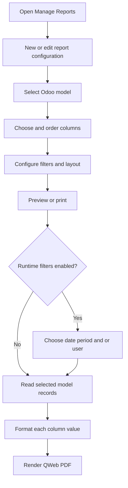

# Dynamic Report Builder — Odoo 19

| Information | Value |
|---|---|
| Module Name | Dynamic Report Builder |
| Technical Name | `dynamic_report_builder` |
| Odoo Version | 19.0 |
| Module Version | `19.0.1.0.0` |
| Author | Softeko_Lamia |
| Category | Reporting |
| License | LGPL-3 |
| Documentation Updated | 2026-10-13 |
| Latest Verified Release | `19.0.1.0.0`; release date not verified |
| Documentation Status | Source-code reviewed; Odoo runtime not tested |

Build configurable PDF reports for selected Odoo models with ordered direct/relational columns, runtime filtering, and reusable print actions.

## Contents

- [Overview](#overview)
- [Features](#features)
- [Architecture](#architecture)
- [Workflow](#workflow)
- [Conditions](#conditions)
- [Validations](#validations)
- [Configuration](#configuration)
- [Synchronization](#synchronization)
- [Security](#security)
- [Technical Reference](#technical-reference)
- [Installation](#installation)
- [Testing](#testing)
- [Troubleshooting](#troubleshooting)
- [Changelog](#changelog)

## Overview

Administrators configure reports by choosing a model, columns and filters rather than writing a dedicated QWeb template for each report. Generated reports are prepared by `dynamic.report.config`, with print-time period/user filters handled by `dynamic.report.date.filter.wizard`. Data is read from the chosen model under the requesting user's Odoo environment. Report configuration and PDF presentation are distinct: report rows are prepared in Python and rendered through QWeb.

## Features

| Feature | Access / trigger | Models and implementation | Behavior |
|---|---|---|---|
| Model and column builder | Dynamic Report → Manage Reports → New | `dynamic.report.config`, `dynamic.report.config.field`; `models/report_config.py`; `views/report_wizard_views.xml` | Select model and sequence ordered columns, including one-hop line model fields |
| Report preview | Preview in config form | `action_generate_report`, `get_report_data`; report XML files | Generate PDF preview using company layout |
| Domain, limit and sort | Configuration form | `domain_filter`, `limit`, `sort_field_id`, `sort_direction` | Restrict and order queried records |
| Date period filtering | Runtime wizard when enabled | `date_filter_wizard.py`, `_get_date_filter_domain` | Yearly, quarterly, monthly, weekly, custom periods |
| User filtering/grouping | Runtime wizard when enabled | `_get_user_filter_domain`, `_get_user_grouped_records` | Select target user; optional separate PDF sections |
| Generated actions/menus | Saving/updating configuration | `_sync_menu_and_action`, `_sync_print_action`, `_sync_bound_print_server_action` | Maintain report launch / Print actions and generated menu records |
| Duplicate report | Form Duplicate button | `action_duplicate_report` | Copy a report configuration |
| Column sizing/alignment | Report Columns tab | `width`, `alignment`, `get_cell_style` | Set PDF table column presentation |
| Attendance duration presentation | Print report | `_format_column`, `_format_value`, `_is_duration_column`, `_format_duration_hours` | Present identified float duration fields as `HH:MM`, including negatives |

**Duration-specific behavior:** Odoo float fields containing decimal hours have a different raw numeric value from the `float_time` display widget. This module recognizes labels/technical names such as **Worked Hours**, **Worked Extra Hours**, and **Overtime Hours**; `-5.2775` becomes `-05:17` and `2.7225` becomes `02:43`. The exact field name in any *external* attendance module has not been verified. Other float fields remain numeric to avoid accidentally converting prices or quantities. Exact duplication of every external custom view widget is not guaranteed.

## Architecture

```text
dynamic_report_builder/
├── __init__.py
├── __manifest__.py
├── models/
│   ├── __init__.py
│   ├── report_config.py
│   └── date_filter_wizard.py
├── views/
│   ├── report_wizard_views.xml
│   └── date_filter_wizard_views.xml
├── report/
│   ├── dynamic_report.xml
│   └── dynamic_report_templates.xml
├── data/runtime_action_sync.xml
├── security/ir.model.access.csv
└── static/src/scss/date_filter_wizard.scss
```

The main configuration is `dynamic.report.config`; its ordered one-to-many lines are `dynamic.report.config.field`, pointing to `ir.model.fields`. Date/user selection uses the transient model `dynamic.report.date.filter.wizard`. Report actions use standard Odoo `ir.actions.report`; the manifest depends on `base` and `web`.

## Workflow



A configured report may also generate a menu or Print action. Existing reports persist in the database; changing the module's documentation does not delete their settings.

## Conditions

| Feature | Trigger | Condition | UI behavior / backend enforcement | Method / file |
|---|---|---|---|---|
| Select fields | Add column | Selected main model and suitable field | View field domain; invalid associations require validation through Odoo models | `report_wizard_views.xml`; `report_config.py` |
| User filter | Enable User Filter | Stored many2one to `res.users` on selected model | UI domain plus Python constraint | `_check_user_filter_field` |
| Date filter | Enable Date Filter | Date/datetime field chosen | UI `required` expression; runtime domain builder | `_get_date_filter_domain` |
| Preview | Click Preview | At least one report column | Backend error when no valid report columns | `action_generate_report` |
| Layout | Edit font sizes | Valid range | Backend constraint | `_check_report_font_sizes` |
| Column width | Edit Width % | 0–100 | Backend constraint | `_check_width` |
| Duration formatting | PDF row preparation | Float with recognized time-oriented label/technical name | Formatting only; does not rewrite stored decimal values | `_is_duration_column` |

## Validations

- `_check_user_filter_field`: prevents invalid user filter relationships.
- `_check_report_font_sizes`: validates font size ranges defined in code.
- `_check_width`: column width must be between 0 and 100.
- `action_generate_report`: refuses printing without report columns.
- Client-side `invisible` / `required` expressions in XML improve usability but are not independent backend security enforcement.

## Configuration

| Field | Type | Purpose / default |
|---|---|---|
| `name` | Char, required | Report title; default `New Report` |
| `model_id` | Many2one `ir.model`, required | Main report model |
| `field_line_ids` | One2many | Ordered columns |
| `field_ids` | Many2many | Legacy field selection kept for migration |
| `domain_filter` | Char | Odoo domain; default `[]` |
| `limit` | Integer | Max records; default 1000 |
| `sort_field_id`, `sort_direction` | Many2one, Selection | Order by model field, ascending by default |
| `enable_date_filter`, `date_field_id` | Boolean, Many2one | Date/datetime range selection |
| `enable_user_filter`, `user_field_id`, `group_by_user` | Boolean, Many2one, Boolean | Runtime user selection and grouping |
| `subtitle`, `show_title`, `show_total_records`, `show_row_number` | Char, Boolean | PDF title, totals and numbering |
| `report_title_font_size`, `table_font_size` | Integer | PDF font sizes; defaults 18 and 9 px |
| `parent_menu_id` | Many2one `ir.ui.menu` | Location of generated report menu |
| `active` | Boolean | Active configuration; default True |

Columns (`dynamic.report.config.field`) store `sequence`, `relation_field_id`, `field_id`, `custom_label`, `width`, and `alignment`. Date wizard fields and period presets are in `models/date_filter_wizard.py`. The actual default generated menu behavior follows `_get_generated_menu_parent` and `_sync_menu_and_action`; do not assume any specific generated menu is permanently hidden.

## Synchronization

| Source | Target | Trigger | Transformation | Method |
|---|---|---|---|---|
| `dynamic.report.config` | Generated `ir.ui.menu` / `ir.actions.server` | Configuration create/write | Action/menu metadata | `_sync_menu_and_action` |
| `dynamic.report.config` | QWeb template / Print action | Configuration change | Generated report/action configuration | `_sync_print_template`, `_sync_print_action` |
| Source model records | Prepared PDF rows | Preview/print | Display formatting; no write-back | `get_report_data`, `_format_column`, `_format_value` |
| Date/user wizard selections | Runtime report domain | Print | Date/user filtering | `_get_date_filter_domain`, `_get_user_filter_domain` |

Report values are read at generation time; they are not synchronized or stored back into source model records by this formatting change.

## Security

Access control is defined in `security/ir.model.access.csv`:

| Model | Group | Read | Write | Create | Delete |
|---|---|---|---|---|---|
| `dynamic.report.config` | System administrator (`base.group_system`) | Yes | Yes | Yes | Yes |
| `dynamic.report.config` | Internal user (`base.group_user`) | Yes | No | No | No |
| `dynamic.report.config.field` | System administrator | Yes | Yes | Yes | Yes |
| `dynamic.report.config.field` | Internal user | Yes | No | No | No |
| `dynamic.report.date.filter.wizard` | Internal user | Yes | Yes | Yes | Yes |

No separate module record-rule XML file exists in the supplied archive. Source model access is governed by the corresponding Odoo model permissions and query context; inspect generated actions and any `sudo()` use before expanding access.

## Technical Reference

| File | Important functions / elements |
|---|---|
| `models/report_config.py` | `DynamicReportConfig`, `DynamicReportConfigField`, `create`, `write`, `unlink`, `_sync_menu_and_action`, `action_generate_report`, `get_report_data`, `_format_column`, `_format_value`, `_is_duration_column`, `_format_duration_hours` |
| `models/date_filter_wizard.py` | `DynamicReportDateFilterWizard`, `_get_period_dates`, `action_print_report`, `action_navigate_period` |
| `views/report_wizard_views.xml` | Configuration form/list, window actions and menus |
| `views/date_filter_wizard_views.xml` | Runtime filter wizard UI |
| `report/dynamic_report.xml` | Report action metadata |
| `report/dynamic_report_templates.xml` | PDF QWeb layout |
| `security/ir.model.access.csv` | Read/write/create/unlink access rights |
| `data/runtime_action_sync.xml` | Data-driven runtime action synchronization |

Source values are formatted without modifying the original database field. Duration sign and hours are preserved, minutes are rounded to the nearest minute.

## Installation

1. Back up the target database and its filestore.
2. Copy the `dynamic_report_builder` folder into an Odoo 19 addons directory.
3. Restart Odoo and update the Apps list.
4. Install or **Upgrade** the existing `dynamic_report_builder` module; do not uninstall an existing module to apply this change.
5. Refresh the browser and generate the Attendance Report PDF again.
6. Check both `Worked Hours` and `Worked Extra Hours`, including positive and negative examples.

Docker installations should run the upgrade command with the correct DB host, DB user, and credentials. Do not publish database credentials in command output.

## Testing

**Proposed QA checks — not executed on a live Odoo server.**

| ID | Test | Expected result |
|---|---|---|
| T01 | Build a new report and select columns | Report configuration can be saved by authorized user |
| T02 | Reorder line columns and preview | PDF follows configured order |
| T03 | Print float Worked Hours 2.7225 | `02:43` |
| T04 | Print float Worked Extra Hours -5.2775 | `-05:17` |
| T05 | Print float Worked Extra Hours 4.3194 | `04:19` |
| T06 | Print a normal float quantity/price | Remains numeric, not hours |
| T07 | Set invalid width > 100 | Backend rejects width |
| T08 | Enable invalid User Field | Backend rejects invalid relationship |
| T09 | Select date period and print | Records filtered by selected date range |
| T10 | Try modifying configuration as regular internal user | ACL prevents unauthorized edits |
| T11 | Upgrade previously installed module | Existing records and report settings remain accessible |
| T12 | Preview without columns | User-facing validation error |

## Troubleshooting

- **Extra hours still decimal**: confirm the selected field is of type float and that its technical name or report label matches the recognized duration fields; a custom unmatched widget needs a targeted mapping. Restart Odoo, upgrade the module and regenerate the PDF.
- **`KeyError: dynamic.report.config` / 404**: confirm module upgrade completed, server registry loaded and the database matches the active URL.
- **Database connection errors in Docker**: use the database container host and configured DB credentials for shell/upgrade processes.
- **`Invalid field groups_id in ir.ui.menu`**: Odoo 19 uses `group_ids`; review menu XML separately if such an upgrade error appears.
- **Unexpected generated menu**: inspect `_sync_menu_and_action` and the report's `parent_menu_id`.

**New developer quick start:** Begin with `__manifest__.py` and `models/report_config.py`, then inspect the form view and QWeb files. Use `_get_runtime_report_records` for query behavior, `_format_column` and `_format_value` for printable values, and `_sync_menu_and_action` for generated menu behavior.

## Changelog

See [CHANGELOG.md](CHANGELOG.md). Documentation dates are not proof of historical feature release dates.


## Internal-user report access (2026-10-13)

The Dynamic Report root menu is now available to internal users (`base.group_user`).
Internal users have read-only access to report configurations and ordered column records
through the existing ACLs; creation and editing still require administrator privileges.
Report execution reads `ir.model.fields` metadata with narrowly scoped `sudo()`
so users lacking the Odoo Access Rights administration group can render columns.
The business model records used for PDF rows continue to be queried in the current
user's normal environment, respecting its access controls and record rules.
Metadata changes do not grant access to confidential source models.

**Upgrade note:** Install/upgrade the module using an administrator, then test
with an internal user having read access to the underlying report model.
Runtime validation in a live Odoo database has not been performed here.


## Admin-only application and shared printing (2026-10-13)

- **Dynamic Report application/menu:** restricted to Settings/Administrator (`base.group_system`); ordinary internal users do not see the standalone application.
- **Attendance > Print:** internal users can use an existing configured report print action from the source model, including its date/user filter popup, without entering the Dynamic Report application.
- **Metadata only:** reads of `ir.model` and `ir.model.fields` technical metadata use scoped `sudo()` as needed; **source report records are queried through the current user environment**, preserving source-model read ACLs and record rules.
- **No automatic privilege escalation:** generating a PDF does not grant the user administrator/configuration rights. A report must first be configured by an administrator.
- **Runtime caveat:** Odoo live installation and a non-admin print test have not been executed here. Test with an ordinary Attendance user, including source record permissions and multi-company filtering.
