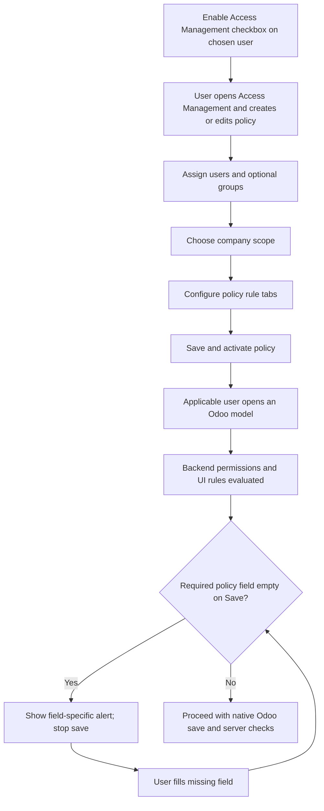

# Access Management — Odoo 19

A policy-based access management module that configures user-, group-, company-, model-, field-, and interface-level restrictions without changing Odoo core source files.

| Information | Value |
|---|---|
| Module name | Access Management |
| Technical module | `permission_manager_basic` |
| Odoo version | 19 (as declared in the manifest) |
| Module version | `19.0.1.0.14` (unchanged) |
| Author | Softeko_Lamia |
| Maintainer / developer | Lamia |
| Category | Administration/Access Rights |
| License | LGPL-3 |
| Dependencies | `base`, `mail`, `web` |
| Documentation updated | **2026-11-09** |
| Latest verified release date | **Not verified**; the manifest supplies a version but no release date |
| Documentation status | Source-code reviewed; Odoo runtime / browser end-to-end testing **not performed** for this documentation update |

## Table of contents

- [Overview](#overview)
- [Single-checkbox app access](#single-checkbox-app-access)
- [Feature inventory](#feature-inventory)
- [Business workflow](#business-workflow)
- [Required field save popup](#required-field-save-popup)
- [Policy configuration](#policy-configuration)
- [Conditions and validations](#conditions-and-validations)
- [Data relationships and synchronization](#data-relationships-and-synchronization)
- [Technical architecture](#technical-architecture)
- [Security and access control](#security-and-access-control)
- [Installation and upgrade](#installation-and-upgrade)
- [Proposed QA test cases](#proposed-qa-test-cases)
- [Troubleshooting](#troubleshooting)
- [New developer quick start](#new-developer-quick-start)
- [Known limitations and verification status](#known-limitations-and-verification-status)
- [Changelog](#changelog)

## Overview

The module provides a centralized **Access Management → Policies** application for Odoo administrators. A policy can be assigned directly to users and optionally to selected Odoo user groups, and scoped to one or more companies. Rule lines customize navigation, model operations, model-specific search UI, form fields, record listing, action/report visibility, chatter, and form buttons/tabs. Active applicable policies are evaluated for the current user; multiple applicable rules can combine restrictions.

**Users and app eligibility:** An Odoo user can open and configure this app only when explicitly assigned the **Access Management** group (`permission_manager_basic.group_permission_manager_user`) via their user Access Rights. The app's root and Policies menus are tied to this one group; membership is **not automatically implied by Settings Administrator**. Policy-assigned users can still experience restrictions on other installed models independently of whether they can open the management app.

**Before:** An administrator would normally configure access using Odoo groups, ACLs, record rules, view inheritance, or custom development. **After:** The module supplies an additional configurable policy layer. It does **not** replace Odoo's native ACLs or guarantee that a hidden UI element is an independent backend authorization check.

**Primary sources:** `__manifest__.py`, `models/permission_manager.py`, `views/permission_manager_views.xml`, `views/menu_views.xml`, `security/*`, `static/src/js/*`, `static/src/css/*`, `static/src/xml/*`.

## Single-checkbox app access

**Current behavior in the supplied ZIP (2026-11-09 access-control revision):** Each user is assigned access to the application using **one group membership**, exposed in the user's Access Rights as **Access Management**. There is no separate live **Access Management Administrator** permission to assign.

| User's Access Management checkbox | App icon and Policies menu | Permissions on the module's ten policy/rule models | Activate / Deactivate Policy buttons |
|---|---|---|---|
| Checked | Eligible to see/open | Read, Create, Write, Delete | Visible when the corresponding state permits |
| Unchecked | Hidden by the module's menu group restriction | No ACL is granted by this module's Access Management group | Not available through the restricted app |

To grant access: open **Settings → Users & Companies → Users**, select the user, find **Access Management** under the user's Access Rights, enable the checkbox, then **Save**. To revoke it, clear the same checkbox and save. Have the user sign out and back in / reload menus after group changes. The location/presentation of group controls can vary with installed Odoo apps and user-form layout.

**Independence from administrator status:** `security/security.xml` removes the previous implied Access Management groups from `base.group_system`, removes the former separate administrator group's ACLs, and retires that group. `views/menu_views.xml` explicitly removes the earlier `base.group_system` menu assignment and adds only `group_permission_manager_user`; `views/permission_manager_views.xml` uses the same group for the Activate/Deactivate actions. In `security/ir.model.access.csv`, all ten custom models now have a single group-owned CRUD row with flags `1,1,1,1`.

**Security boundary:** This grant controls the management app's menus and the module's own ACL contributions. Odoo superuser mode, other installed modules' ACLs, `sudo()` calls, and native Odoo rights can affect what an account can access; a hidden app is not a universal guarantee against access through custom integrations. **Policy application to target business models is separate from permission to manage policies.** Changes were source-reviewed, not runtime-tested in a live Odoo instance.


## Feature inventory

| Feature | Configuration / action | Code path and trigger | Expected behavior |
|---|---|---|---|
| Single-checkbox app eligibility | User → Access Rights → Access Management | `security/security.xml`, `security/ir.model.access.csv`, `views/menu_views.xml` | Controls management app visibility and full CRUD permission for the ten module policy/rule models independently of Settings Administrator |
| User and group assignment | Policy → Users; Apply by User Groups + User Groups | `PermissionManagerPolicy._assignment_domain_for_user()` | Direct users and optionally matching group members receive policy restrictions |
| Company scope | Apply regardless Company / Companies | `_company_domain()`, `_applicability_domain_for_user()` | Restricts matching to selected company when all-company scope is disabled |
| Policy activation | Activate / Deactivate | `action_activate_policy()` / `action_deactivate_policy()` | Enables/disables the policy state and active flag |
| Menus / submenus | Hide Menus/Submenu | `PermissionManagerHiddenMenuLine`, `IrUiMenu._visible_menu_ids()` | Hides matching navigation items; optional condition is evaluated against the user |
| Model-level operations | Model Permissions | `PermissionManagerModelPermissionLine`, `Base._permission_manager_check_operation()` | Blocks configured read/create/edit/delete/archive/unarchive/duplicate/import/export operations where matching |
| Hide model | Model Permissions → Hide Model | `_is_model_hidden_for_current_user()`, `Base.get_view()`, `IrUiMenu._visible_menu_ids()` | Hides model menus and invokes additional model access blocks |
| Reports / bound actions | Model Permissions → Reports / Actions | `IrActionsActions.get_bindings()`, `get_hidden_bindings_for_records()`; JS action-menu patch | Hides selected model-bound reports and actions, including record-dependent selection handling |
| View switcher choices | Model Permissions → Hide List / Form / Kanban / Calendar / Pivot / Graph / Activity / Map | `get_hidden_view_types_for_current_user()`, `static/src/js/view_switcher_access.js` | Removes specified choices from client view switcher rather than blanking view architecture |
| Search Panel | Search Panel tab | `get_search_panel_access()`, `static/src/js/search_menu_access.js`, `static/src/xml/search_menu_access.xml` | Hides search dropdown or subsets such as Filters, Group By, Favorites, Custom Filter, Custom Group By, Save Current Search |
| Spreadsheet UI | Model Permissions → Spreadsheet | `is_spreadsheet_blocked_for_current_user()`, 3 spreadsheet/action-menu JS patches | Hides known spreadsheet entry points in relevant model UI |
| Field hide, read only, required | Field Controls → Attribute Rule | `_get_field_rules_for_current_user()`, `Base.get_view()`, `_permission_manager_check_field_values()` | Applies unconditional field controls, and conditional view modifiers |
| Field import/export visibility | Field Controls → Import / Export | `Base.fields_get()`, `Base.export_data()` | Removes metadata availability; server-side export checks restrict no-export/hidden fields |
| Field conditional behavior | Field Controls → Condition / Apply On; legacy field-state rules | `_get_state_rules_for_current_user()`, `_normalize_condition_expression()`, `Base.get_view()` | Adds expression-driven invisible / readonly / required modifiers to selected view types |
| Required-field popup | Field Controls → Required; user presses Save | `Base.get_view()` marker and `static/src/js/required_field_save_popup.js` | Shows field-specific alert and prevents that save attempt when a controlled, visible, required field is empty |
| Record Domain Rules | Record Domain Rules | `_evaluate_filter_domain()`, `Base.web_search_read()` | Narrows matching list/search results for configured Read scope |
| Buttons / notebook tabs | Hide Buttons/Tabs | `_sync_from_model()`, `_get_hidden_item_keys_for_current_user()`, `Base.get_view()` | Hides selected form buttons/tabs, optionally conditionally |
| Chatter visibility | Chatter Visibility | `_get_flags_for_current_user()`, `Base.get_view()`, `static/src/css/chatter_visibility.css` | Hides chatter or configured composer/log/activity/search/attachment/follower UI portions |
| Global force read only | Global Controls | `_is_force_read_only_for_current_user()`, `Base._permission_manager_blocked_operations()` | Blocks create/update/delete and other listed write-side operations |
| Block login | Global Controls | `_is_login_blocked_for_user()`, `ResUsers._check_credentials()` | Denies login after credential verification when a matching active policy blocks it |
| Block debug mode | Global Controls | `is_current_user_debug_blocked()`, `static/src/js/block_debug_mode.js` | Removes/debug-blocks the targeted backend debug entry point |
| Export available-field browser | Global Controls | `is_current_user_export_available_fields_hidden()`, `export_data_dialog_control.js`, XML template | Hides selected controls of Odoo's Export Data dialog |
| Policy search and smart navigation | Policy search / smart buttons | Policy views + `action_open_*()` | Opens filtered line lists/forms with default policy context |

**Scope note:** A checkbox for a feature is not proof of complete enforcement across all APIs. See [Known limitations and verification status](#known-limitations-and-verification-status).

## Business workflow

1. A user with native permission to edit user access rights enables **Access Management** on the designated policy manager account; that user opens **Access Management → Policies** and creates a policy with a name.
2. The administrator chooses directly assigned `user_ids`, or enables `apply_by_user_groups` and selects `group_ids`; optionally restricts applicability with `apply_all_companies=False` and `company_ids`.
3. In the relevant policy tab, the administrator configures model/field/menu/search/domain/chatter/button/tab/global rules.
4. The administrator saves; the rule-line `create()` / `write()` / `unlink()` methods clear relevant menu/view/registry caches, where implemented.
5. An applicable user opens an Odoo model. Server overrides and backend JS assets evaluate the active policy. Form XML may be modified for field attributes, chatter and buttons/tabs. Model/field operations may be restricted server-side.
6. On form Save, field-specific Required alert behavior applies as described in the next section. A policy can be deactivated by the administrator.



**Alternative paths:** Policy lines are editable directly through the smart-button actions; policies can be activated/deactivated; existing policies can use any of the listed rule tabs independently. This module does not implement CRM-to-sales or inventory business-process synchronization.

## Required field save popup

This feature is **present in the supplied ZIP**, not newly implemented by this documentation-only update.

**Configuration:** Open **Access Management → Policies → Field Controls**. Select a Model and Field, enable the Attribute Rule as appropriate, select **Required**, choose the intended Apply On view(s), and save the policy. For regular form popup behavior, the configured rule must apply to **Form**. An optional condition can make Required conditional on the current form record.

**Save-time sequence:**

1. `Base.get_view()` sets `required="1"` on matching fields for unconditional rules or a conditional `required` expression for state rules. In form views it additionally sets `data-pm-required-popup="1"` (`models/permission_manager.py`, `Base.get_view()`).
2. Backend assets load `static/src/js/required_field_save_popup.js`. It patches `FormController.save()` and `FormController.beforeExecuteActionButton()` for a footer button with `special="save"`.
3. The handler inspects marked fields belonging to the root form record, skipping nested fields, invisible fields and fields that Odoo does not currently regard as required.
4. If a relevant field is empty, the dialog service opens `AlertDialog` with title **Required Field** and body **`<Field Label> is required. Please fill it in before saving.`**. It returns `false` instead of proceeding with that save.
5. Once filled in, the user can retry Save. `Base.create()` / `Base.write()` also call `_permission_manager_check_field_values()` for applicable **unconditional** field rules, raising `UserError` on missing required values according to their respective create/write checks.

**Example:** Required on `Customer` → user saves an otherwise complete form without Customer → popup: `Customer is required. Please fill it in before saving.`

**Important differences:**

- This is a **client-side, form-save popup**, plus the existing server-side checks for unconditional required fields. It is not an all-client-path or all-API validation guarantee.
- The JS explicitly ignores boolean, float, integer and monetary fields for the popup, following its own handling of Odoo form validation. It handles relational collections and JSON/HTML differently from ordinary scalar fields.
- The JS marker is put on the model's form view; the root-form check skips nested one2many subfields.
- Server-side `create` checks unconditional required values passed in `vals`; `write` validates required fields **when present in incoming `vals`**. Conditional required expressions are view modifiers, not general-purpose Python constraints.
- Ordinary Odoo-required fields not marked by this policy still use native Odoo validation.

## Policy configuration

### Policy identity and assignment

| Field | Type / default | Meaning |
|---|---|---|
| `name` | Char / required | Policy Name |
| `sequence` | Integer / `10` | Ordering |
| `active` | Boolean / `True` | Active archive flag |
| `state` | Selection / `active` | Explicit Active/Inactive workflow status |
| `user_ids` | Many2many → `res.users` / empty | Direct user assignments |
| `apply_by_user_groups` | Boolean / `False` | Enable group matching |
| `group_ids` | Many2many → `res.groups` / empty | Group members included when enabled |
| `apply_all_companies` | Boolean / `True` | Ignore company filtering if enabled |
| `company_ids` | Many2many → `res.company` / empty | Company scope if all-company disabled |

Applicability is the conjunction of direct-user **or enabled-group** assignment and company match. Group matching contains upgrade-time table/column readiness checks in `_group_assignment_schema_ready()`.

### Configuration tabs and models

| Policy tab / section | Stored relation / related model | Important fields and defaults | Operational entry point |
|---|---|---|---|
| Hide Menus/Submenu | `hidden_menu_line_ids` → `permission.manager.hidden.menu.line` | `menu_id` required, `active=True`, `condition_expression='[]'` | `_get_hidden_menu_ids_for_current_user()` |
| Model Permissions | `model_permission_line_ids` → `permission.manager.model.permission.line` | `model_id` required, operation checkboxes false, `condition_expression='[]'`, selected reports/actions/views | `_get_blocked_operations_for_current_user()` |
| Search Panel | `search_panel_line_ids` → `permission.manager.search.panel.line` | `model_id` required; all hide toggles false | `get_search_panel_access()` |
| Field Controls | `field_permission_line_ids` → `permission.manager.field.permission.line` | `model_id`, `field_id` required; `active=True`; `enable_attribute_rule=True`, `enable_domain_rule=False`; `apply_form=True`, `apply_list=True`, `apply_kanban=False`, `apply_search=False`; all block flags false | `_get_field_rules_for_current_user()` / `_get_state_rules_for_current_user()` |
| Legacy field-state records | `field_state_rule_line_ids` → `permission.manager.field.state.rule.line` | `enable_attribute_rule=False`, `enable_domain_rule=False`, `attribute_behavior` optional, `condition_expression='[]'` | Legacy `_get_state_rules_for_current_user()`; model exists, not a dedicated visible policy tab in current XML |
| Record Domain Rules | `record_domain_rule_line_ids` → `permission.manager.record.domain.rule.line` | `filter_expression='[]'`, `scope_read=True`, other scopes false, `active=True` | `_get_domain_for_current_user()` |
| Chatter Visibility | `chatter_visibility_line_ids` → `permission.manager.chatter.visibility.line` | `model_id` required, all hide flags false, `active=True` | `_get_flags_for_current_user()` |
| Hide Buttons/Tabs | `hide_button_tab_line_ids` → `permission.manager.hide.button.tab.line` | `model_id` required; `condition_expression` optional; selected button/tab item IDs; `active=True` | `_get_hidden_item_keys_for_current_user()` |
| Global Controls | on `permission.manager.policy` itself | `force_read_only=False`, `block_debug_mode=False`, `block_login=False`, `hide_export_available_fields=False` | policy helper methods |

All rule-line models use a mandatory `policy_id` Many2one with `ondelete='cascade'`. Related technical model/field names are derived from `ir.model` / `ir.model.fields` rather than synchronized copies of arbitrary business data.

### Model Permissions — details

`model_id` is restricted to the chosen model. `report_ids` has domain `model == selected model`, `action_ids` uses `binding_model_id == model_id`, and `hidden_view_ids` uses `ir.ui.view.model == selected model`. Select any of: `block_read`, `block_create`, `block_edit`, `block_delete`, `block_archive`, `block_unarchive`, `block_duplicate`, `block_import_data`, `block_export_data`, `block_spreadsheet`; or hide action menu, entire model, or view-switcher choices. A condition domain can apply to record-specific operation and action/report decisions, but view-switcher types are model-level and do not depend on a particular record.

### Search Panel — details

Select a **non-transient** model. The tab offers `hide_search_menu`, `hide_filters`, `hide_group_by`, `hide_favorites`, `hide_custom_filter`, `hide_custom_group_by`, and `hide_save_current_search`. A legacy `hide_custom_filter` setting from Model Permissions is also read for backward compatibility. JS patches affect Odoo's search model, search bar and search menu components.

### Field Controls — details

An active field rule targets a field belonging to the selected model. On the **Attribute Rule** section, set `hide_field`, `read_only`, `required`, `condition_expression` and Apply On toggles (`apply_form`, `apply_list`, `apply_kanban`, `apply_search`). An unconditional Hide Field marks the field unavailable to several metadata selectors, even when Apply On toggles differ. Conditional attributes operate as client view expressions; unconditional read-only/required also participate in server `create()` / `write()` validation as implemented. The Import / Export section has `no_import`, `no_export`.

The **Domain Rule** configuration stores `relational_field_id` (Many2one or Many2many field on the selected model) and `selection_domain`. The provided Python code includes field validation and mode/reset behavior for these values; an actual view or ORM consumer applying the stored `selection_domain` was **not found** in the supplied code. Do not assume the relational domain filter is enforced without a dedicated runtime test or implementation review.

Turning off `enable_attribute_rule` clears hide/read-only/required and resets condition; turning off `enable_domain_rule` clears relational field and selection domain. `_prepare_rule_mode_values()` performs equivalent resets for saved values.

### Record Domain Rules — details

`filter_expression` must evaluate to an Odoo domain list. A chosen `current_user_field_id` appends a filter equivalent to `(field, '=', current_user.id)`. Scope switches exist for Read, Write, Create, Delete; `soft_restriction` is stored/computed when Read is enabled without the write/create/delete scopes. **Only the Read-scope `web_search_read()` integration could be verified in this supplied Python source**; do not treat other scope checkboxes as confirmed backend enforcement.

### Hide Buttons/Tabs — details

The helper scans the selected model's view architecture and collects available button/tab items in `permission.manager.hide.item` with technical keys (`_sync_from_model()`). A policy line selects these items and optionally a condition. The user-visible Refresh Available Items action calls `action_refresh_available_items()`. `Base.get_view()` composes button/page `invisible` conditions; nested line buttons use parent-field transformations where applicable. This is UI hiding, not a general-purpose prohibition on calling an underlying button method by RPC.

### Chatter Visibility — details

Available switches: `hide_chatter`, `hide_composer`, `hide_log_note`, `hide_schedule_activity`, `hide_search_messages`, `hide_attachments`, `hide_followers`, `hide_follow_button`. The server modifies the form `<chatter>` element/classes; CSS hides the corresponding UI portions.

### Global Controls — details

These settings live on the policy itself and are edited in the Global Controls form dialog: company scope fields plus Force Read-Only, Block Debug Mode, Block Login, and Hide Export Available Fields. All default to false except Apply regardless Company (true).

## Conditions and validations

The following describes **actual implementation entry points**, distinguishing server errors from form UI modifiers.

| Rule | Trigger | Condition | Outcome | Method/file and enforcement |
|---|---|---|---|---|
| Missing required policy name | Policy create/write | `name` missing | Odoo field-required error | `PermissionManagerPolicy.name`; ORM required=True |
| Duplicate menu in policy | Rule create/write | Same `policy_id` + `menu_id` | Database uniqueness violation | `PermissionManagerHiddenMenuLine._sql_constraints`; database |
| Duplicate model permission | Rule create/write | Same policy + model | Database uniqueness violation | `PermissionManagerModelPermissionLine._sql_constraints`; database |
| Duplicate Search Panel model | Rule create/write | Same policy + model | Database uniqueness violation | `PermissionManagerSearchPanelLine._sql_constraints`; database |
| Duplicate Field Control field | Rule create/write | Same policy + model + field | Database uniqueness violation | `PermissionManagerFieldPermissionLine._sql_constraints`; database |
| Duplicate hide-button/tab model | Rule create/write | Same policy + model | Database uniqueness violation | `PermissionManagerHideButtonTabLine._sql_constraints`; database |
| Duplicate chatter model | Rule create/write | Same policy + model | Database uniqueness violation | `PermissionManagerChatterVisibilityLine._sql_constraints`; database |
| Invalid controlled technical field | Field Control or legacy rule save | Protected system field (`id`, `display_name`, audit fields, etc.) | `UserError` | `_check_field_id()`; server `@api.constrains` |
| Invalid relational model | Field Control save | Relational field model ≠ selected model | `UserError` | `PermissionManagerFieldPermissionLine._check_field_id()`; server |
| Missing legacy Target Field | Legacy state-rule save | Attribute Rule enabled, field not chosen | `UserError` | `_check_attribute_rule_required_fields()`; server |
| Invalid menu / model / button condition | Rule save | Condition not valid domain/list as specified | `UserError` | corresponding `_check_condition_expression()` methods; server |
| Invalid record filter | Record Domain Rule save | Invalid domain or not executable against selected model | `UserError` | `_check_filter_expression()`; server |
| Transient Search Panel model | Search Panel save | selected `ir.model.transient` | `UserError` | `PermissionManagerSearchPanelLine._check_model_id()`; server |
| Read-only / hidden field submitted | Business model create/write | Applicable unconditional field in `vals` | `UserError` | `Base._permission_manager_check_field_values()`; server |
| Unconditional Required missing on create | Business model create | Required field absent/empty in `vals` | `UserError` with label | `Base.create()` → field validation; server |
| Unconditional Required emptied on write | Business model write | Required field in `vals` becomes empty | `UserError` with label | `Base.write()` → field validation; server |
| Controlled Required missing on form Save | Form Save action | Marked root field is visible, evaluated required, empty | `AlertDialog`; save attempt stopped | `required_field_save_popup.js`; client |
| Model create/read/edit/etc restricted | Business model operation | Matching active policy/model operation | `AccessError` for read; `UserError` for other operations | `Base._permission_manager_check_operation()`; server |
| Read-scope record domain | Web list/search | Active policy and rule match model/user/company | Narrows returned rows | `Base.web_search_read()`; server search endpoint |
| View modifier restriction | Load Odoo view | Matching field, button, tab or chatter rule | Modified XML or CSS class | `Base.get_view()` / CSS; UI only unless independent backend check exists |
| Login restriction | Valid credential check | Active applicable Block Login policy | `AccessDenied` | `ResUsers._check_credentials()`; server |
| Export field restriction | Export | `no_export` or unconditional hidden field requested | `UserError` | `Base.export_data()`; server |

### Conditions and multiple records

- Policy activation needs both `policy.active=True` and `policy.state='active'` in rule lookups.
- Rule-line `active=True` is checked where the line defines that flag.
- Conditional model-operation blocks trigger if **any** selected record matches; conditional report/action hiding uses **all** selected records matching. See `_condition_matches_any_record()` vs. `_condition_matches_records()`.
- `get_hidden_view_types_for_current_user()` makes model-level choices without evaluating record-level conditions.
- Saved condition syntax may be a graphical domain string or, for field-state views, a normalized expression; its applicability depends on the specific rule implementation.

## Data relationships and synchronization

This module is an **access policy subsystem**, not a business-data synchronization module.

| Source model.field | Target / consumer | Trigger | Transformation / direction | Method |
|---|---|---|---|---|
| `permission.manager.policy.user_ids` | Policy applicability | Logged-in user policy lookup | Direct user many2many membership → matching policies | `_assignment_domain_for_user()` |
| `permission.manager.policy.group_ids` | Policy applicability | User/group assignment change or lookup | Group membership, gated by `apply_by_user_groups` | `_assignment_domain_for_user()` |
| `permission.manager.policy.company_ids` | Policy applicability | Current-company lookup | Company matching unless `apply_all_companies` | `_company_domain()` |
| `*.policy_id` | `permission.manager.policy.*_line_ids` | Rule line create/write/unlink | Many2one ↔ One2many relationship | Model fields; no separate copied business values |
| `permission.manager.field.permission.line.field_id` | `field_name`, `field_description` | Read of related fields | Related metadata from `ir.model.fields` | Field definitions |
| `permission.manager.model.permission.line.model_id` | `model` | Read of related field | Stored related technical model name | Field definitions |
| Selected UI model `ir.model` and form XML | `permission.manager.hide.item` | Refresh / rule create | Discover button and page keys | `_sync_from_model()` |
| Field Control `required` + condition | Form XML `required` + marker | Business model `get_view()` | One-way runtime view modifier | `Base.get_view()` |
| Record Domain `filter_expression` + current user field | Web search domain | `web_search_read()` | Conjunctive search filter | `_evaluate_filter_domain()`, `Base.web_search_read()` |
| Policy global and model flags | Client UI / ORM checks | Form load, operations, client RPC | Dynamic restrictions, not a stored copy of records | `Base.*`, client JS assets |

**Cache invalidation:** Policy and many line records clear Odoo menu/view caches after create/write/delete; user group/company updates trigger clearance in `ResUsers.write()`. This affects visibility refresh, not data replication.

**Business-data behavior:** The module does not implement CRM, customer ranking, sales, purchase, inventory, GDN, job code, or synchronization among those workflows. Its generic access checks may apply to installed business models, except guarded framework/internal models.

## Technical architecture

### File and folder structure

```text
permission_manager_basic/
├── __init__.py
├── __manifest__.py
├── README.md                     # Documentation, 2026-11-09
├── CHANGELOG.md                  # Documentation, 2026-11-09
├── models/
│   ├── __init__.py
│   └── permission_manager.py     # Policy, rule models and ORM overrides
├── views/
│   ├── permission_manager_views.xml
│   └── menu_views.xml
├── security/
│   ├── security.xml
│   └── ir.model.access.csv
├── data/
│   └── cleanup_stale_assets.xml
└── static/
    ├── description/             # App page, icon, image assets
    └── src/
        ├── css/                 # Access Management UI + chatter hiding
        ├── js/                  # Backend UI and required-save popup patches
        └── xml/                 # Search/export/view-switcher templates
```

### Python models and entry points

| Python class | Odoo model | Responsibility |
|---|---|---|
| `PermissionManagerPolicy` | `permission.manager.policy` | Policy definition, scope evaluation, smart actions, status and caches |
| `PermissionManagerHiddenMenuLine` | `permission.manager.hidden.menu.line` | Navigation visibility and optional user condition |
| `PermissionManagerModelPermissionLine` | `permission.manager.model.permission.line` | Model operations, selected reports/actions, switcher types and spreadsheet |
| `PermissionManagerSearchPanelLine` | `permission.manager.search.panel.line` | Model-wise search UI flags and RPC accessor |
| `PermissionManagerFieldPermissionLine` | `permission.manager.field.permission.line` | Unified field attribute, import/export, stored domain rule configuration |
| `PermissionManagerFieldStateRuleLine` | `permission.manager.field.state.rule.line` | Legacy conditional attribute rules |
| `PermissionManagerRecordDomainRuleLine` | `permission.manager.record.domain.rule.line` | Domain evaluation and matching record-rule configuration |
| `PermissionManagerHideItem` | `permission.manager.hide.item` | Discovered button/tab item catalog |
| `PermissionManagerHideButtonTabLine` | `permission.manager.hide.button.tab.line` | Model-wise button/tab hidden settings |
| `PermissionManagerChatterVisibilityLine` | `permission.manager.chatter.visibility.line` | Chatter UI control flags |
| `IrModel`, `PermissionManagerHideItemSync` | `ir.model`, existing hide-item model | Button/tab discovery from views |
| `Base` | `base` | Generic ORM hooks (`create`, `write`, `unlink`, `copy`, `read`, `load`, `export_data`, `fields_get`, `get_view`, `web_search_read`) |
| `IrActionsActions` | `ir.actions.actions` | Hide bound actions/reports |
| `IrUiMenu` | `ir.ui.menu` | Remove hidden menus from navigation |
| `ResUsers` | `res.users` | Group/company cache invalidation and login block |

### Frontend and XML asset inventory

| Path | Purpose |
|---|---|
| `static/src/js/required_field_save_popup.js` | FormController required-field AlertDialog on Save |
| `static/src/js/search_menu_access.js` | Search dropdown, Custom Filter and related controls |
| `static/src/js/view_switcher_access.js` | Model-wise view switcher option restrictions |
| `static/src/js/conditional_action_menus.js` | Dynamic selected-record action/report/spreadsheet entries |
| `static/src/js/spreadsheet_cog_menu_access.js` | Cog menu spreadsheet handling |
| `static/src/js/spreadsheet_model_guard.js` | Additional spreadsheet UI hiding |
| `static/src/js/export_data_dialog_control.js` | Export Data dialog restrictions |
| `static/src/js/block_debug_mode.js` | Debug mode restriction |
| `static/src/css/permission_manager_ui.css` | Policy interface styling |
| `static/src/css/chatter_visibility.css` | Chatter UI hiding classes |
| `static/src/xml/export_data_dialog.xml` | Export dialog XML extension |
| `static/src/xml/search_menu_access.xml` | Search UI XML extension |
| `static/src/xml/view_switcher_access.xml` | View switcher XML extension |
| `data/cleanup_stale_assets.xml` | Removes stale `ir.asset` XML paths matching module prefix, while excluding export dialog XML |

`__manifest__.py` registers backend assets and the XML/CSV data files. There is **no separate wizard, controller, QWeb PDF report, cron, business sequence, or SQL view implementation** in the supplied module. Direct SQL is present for table-existence checks; domain parsing uses Odoo evaluation utilities, and the XML views target Odoo 19 syntax.

## Security and access control

`security/security.xml` defines **one active group for the Access Management app**:

- `permission_manager_basic.group_permission_manager_user`: user-facing name **Access Management**. Assign it explicitly to every user who may manage Access Management policies.
- The old `permission_manager_basic.group_permission_manager_admin` is referenced as a short-lived migration record, its legacy ACLs are deleted, and the group is then deleted during data loading. It is **not** an independently selectable role in the final installed configuration.
- `base.group_system` (Settings Administrator) has the previous Access Management implications removed; Settings Administrator alone must **not** grant access to this app.

**ACL matrix:** `security/ir.model.access.csv` contains **one row per custom model**, assigned to the same `group_permission_manager_user`. Every row gives full **Read / Write / Create / Delete** (1/1/1/1). There is no remaining Administrator-specific row in the current file.

| Module model | Access Management checked | Access Management unchecked — rights granted by this module |
|---|---|---|
| `permission.manager.policy` | Full CRUD | None |
| `permission.manager.hidden.menu.line` | Full CRUD | None |
| `permission.manager.model.permission.line` | Full CRUD | None |
| `permission.manager.search.panel.line` | Full CRUD | None |
| `permission.manager.hide.button.tab.line` | Full CRUD | None |
| `permission.manager.hide.item` | Full CRUD | None |
| `permission.manager.chatter.visibility.line` | Full CRUD | None |
| `permission.manager.field.permission.line` | Full CRUD | None |
| `permission.manager.field.state.rule.line` | Full CRUD | None |
| `permission.manager.record.domain.rule.line` | Full CRUD | None |

Both the root **Access Management** app menu and its **Policies** submenu use the `groups="-base.group_system,permission_manager_basic.group_permission_manager_user"` update in `views/menu_views.xml`. The leading `-base.group_system` removes the old Settings Administrator menu grant when upgrading the existing menu records. The policy form's **Activate Policy** and **Deactivate Policy** buttons use `groups="permission_manager_basic.group_permission_manager_user"`.

**Upgrade significance:** Users who previously relied solely on an implied Settings Administrator / Access Management Administrator role **must be explicitly granted the Access Management checkbox** after the new version is loaded. The separate old Administrator group is retired; the single surviving group can now edit policies rather than being read-only.

No custom `ir.rule` records are declared in `security/security.xml`; the module uses its own runtime model/domain machinery, in addition to Odoo's native permissions. Code deliberately bypasses generic policy checks for internal framework models (`permission.manager.*`, `ir.*`, `mail.*`, `web.*`, `bus.*`, `base.*` and explicitly listed bootstrap `res.*` models). It also preserves special view/field/search behavior for certain accounting reconciliation models while keeping operation checks.

`sudo()` is used in policy lookups, rule evaluations, and discovery; the intended restrictions therefore depend on explicit user/company policy-domain checks rather than the current user's CRUD permissions to read policy records. The app/menu/ACL configuration describes this module's **grants**, not an absolute denial against superuser mode, ACLs contributed by other modules, or custom access paths.

## Installation and upgrade

1. Use a compatible **Odoo 19** installation with `base`, `mail`, `web`; retain the module's `permission_manager_basic` technical directory name.
2. Back up the database and any customized module copy before upgrading.
3. Place/extract the `permission_manager_basic` folder in an Odoo configured add-ons directory, or deploy it through the supported module deployment workflow.
4. Restart Odoo (if using filesystem add-ons) and update the Apps list when necessary.
5. Install **Access Management**, or **Upgrade** the installed module. This documentation-only ZIP keeps the manifest version at `19.0.1.0.14`; **explicitly upgrade** an already-installed module to apply the previous ZIP's access-group/ACL/menu changes.
6. From a user account authorized to manage Odoo user access rights, navigate to **Settings → Users & Companies → Users** and explicitly enable the **Access Management** checkbox on each account intended to manage the app. **Settings Administrator alone no longer auto-grants access.** Ensure a recoverable account has the checkbox before relying on policy screens.
7. Have the newly granted user sign out/back in or reload menus. Confirm the app appears only when the box is checked; test its create/edit/delete/activate controls with a dedicated test database. Refresh backend browser assets (hard refresh if old JS bundles remain cached) and confirm backend JS is registered in `web.assets_backend`.
8. Open **Access Management → Policies** as a checked user. Start with a test user and a low-risk test model before deploying restrictive policies to production.

**Illustrative command-line upgrade** (adapt database, config file, executable, deployment paths):

```bash
./odoo-bin -c /path/to/odoo.conf -d YOUR_DB -u permission_manager_basic --stop-after-init
```

This update of `README.md`/`CHANGELOG.md` introduces no additional executable change. The **underlying previously updated ZIP** already contains a security migration in `security/security.xml` (old admin group/ACL retirement), the new full CRUD CSV grants, and menu/button group changes. It is important to run a normal module upgrade to load that previous functional change. The manifest version is not incremented. Production install/upgrade testing has not been performed here.

## Proposed QA test cases

These tests are **proposed**; they have **not** been executed during this documentation update.

| ID | Preconditions | Steps | Expected result | Relevant implementation |
|---|---|---|---|---|
| AM-001 | User explicitly has Access Management checkbox | Open Access Management; create a named policy | Policy saved and visible | policy model, menu and ACLs |
| AM-024 | User without Access Management checkbox | Sign in; inspect app launcher and menus | App root and Policies menu absent for that user | `views/menu_views.xml`, `security/security.xml` |
| AM-025 | User with Access Management checkbox | Create, read, edit, and delete a test policy/rule record | All four operations permitted by module ACLs, subject to other Odoo restrictions | `security/ir.model.access.csv` |
| AM-026 | Settings Administrator **without** Access Management checkbox | Sign in as Settings Administrator; inspect menus | App not automatically exposed through `base.group_system` | `security/security.xml`, `views/menu_views.xml` |
| AM-027 | Same account as AM-024 | Check the group and reload/login, then uncheck and reload/login | Menu shows only while checkbox is selected; no separate app Administrator checkbox | `security/security.xml`, `views/menu_views.xml` |
| AM-028 | Existing installation with old Administrator group/ACL grants | Back up DB, upgrade module, verify groups/ACLs, explicitly set checkbox for intended managers | Old admin group/grants retired, single surviving Access Management group controls access, policy records preserved | `security/security.xml`, `security/ir.model.access.csv` |
| AM-029 | Checked user, active/inactive policy | Open policy and test Activate/Deactivate by state | Both state-appropriate buttons available to group member | `views/permission_manager_views.xml` |
| AM-002 | Test user assigned directly | Activate applicable policy; open target model | Matching restrictions applied | `_assignment_domain_for_user()` |
| AM-003 | Group-assigned policy | Enable group assignment; add user to selected group | Group member receives restrictions | `_group_assignment_schema_ready()`, `_assignment_domain_for_user()` |
| AM-004 | Multi-company user | Set Apply regardless Company off; select company | Rules only when company matches | `_company_domain()` |
| AM-005 | Active Required rule on a normal Char field, form target | Leave field empty and click form Save | Popup names that field and save stops | `Base.get_view()`, `required_field_save_popup.js` |
| AM-006 | Same as AM-005 | Enter value and Save | Save proceeds if other Odoo constraints pass | same |
| AM-007 | Conditional Required rule configured | Save once condition false, once true | Popup only when form evaluates field required and visible | `_get_state_rules_for_current_user()`, popup JS |
| AM-008 | Unconditional Required field configured | Attempt ORM create without value | `UserError` naming missing field | `Base.create()`, `_permission_manager_check_field_values()` |
| AM-009 | Existing record and required field | Attempt write setting required field to empty | `UserError` | `Base.write()`, `_permission_manager_check_field_values()` |
| AM-010 | Controlled field + hidden/read-only | Edit a blocked field via UI and RPC test | View restriction and backend validation where defined | `Base.get_view()`, `_permission_manager_check_field_values()` |
| AM-011 | Model operation blocked | Try target operation | Expected read AccessError or other UserError | `_permission_manager_check_operation()` |
| AM-012 | Search Panel rule on non-transient model | Hide Custom Filter, test search UI entries | Configured entries hidden | `get_search_panel_access()`, search JS |
| AM-013 | Model Permissions view switches | Hide Kanban, keep Form | Kanban option removed, valid Form remains | `get_hidden_view_types_for_current_user()`, switcher JS |
| AM-014 | Menu/Model Hide rule | Open menu with test user | Matched navigation not shown | `IrUiMenu._visible_menu_ids()` |
| AM-015 | Record Domain Read rule | Search/list records as assigned user | Rows filtered by configured domain | `Base.web_search_read()` |
| AM-016 | Chatter rule | Hide composer / followers on mail-enabled form | Selected UI portions hidden | `Base.get_view()`, chatter CSS |
| AM-017 | Button/tab rule | Refresh available items; hide one item | Chosen form button/tab invisible | `_sync_from_model()`, `Base.get_view()` |
| AM-018 | No Export on field | Attempt export with restricted field | `UserError` / field unavailable | `Base.export_data()`, `fields_get()` |
| AM-019 | Block Login on test account | Sign out and attempt new login | Login denied | `ResUsers._check_credentials()` |
| AM-020 | Policy inactive | Deactivate; reload test account session/form | Rule no longer applies | policy state and applicability |
| AM-021 | Existing upgraded instance | Upgrade module; explicitly grant checkbox; hard refresh | Existing configuration retained; new menu/ACL setup and backend JS present | manifest assets / module data |
| AM-022 | Domain Rule configured | Set relational selection domain and test selector | **Verify behavior separately; not confirmed by present source** | `selection_domain` storage only |
| AM-023 | Record Domain Write/Create/Delete scoped | Attempt out-of-domain mutations | **Verify separately; no enforcement hook established in current source** | `scope_*` fields, Base hooks |

Include negative cases for duplicate rule lines, protected technical fields, invalid domain strings, unauthorized policy editing, missing target model/field, and mixed selected-record conditional rules. Test account group membership and company switching explicitly.

## Troubleshooting

| Symptom | Check | Safe next step |
|---|---|---|
| Access Management app missing after upgrade | Access Management checkbox absent, old Settings Administrator implication removed, session menu cache | Explicitly assign the **Access Management** group on the user; Save, sign in again, and verify `views/menu_views.xml` group assignment |
| App appears without checkbox | User group inheritance/custom groups, another module altering menu groups, stale session, or Odoo superuser mode | Verify effective groups and native/menu security, repeat in ordinary test account; inspect any custom menu/ACL grants |
| User sees app but cannot edit policies | Group not saved/effective, restrictive third-party record rule, or stale ACL registry | Verify single Access Management group and full CRUD rows, upgrade module, use a normal test account |
| Required popup does not appear | Active policy, matching user/company, Field Controls → Required, Form Apply On, loaded `required_field_save_popup.js` | Inspect generated form XML for `data-pm-required-popup`; upgrade module and hard-refresh browser |
| Popup names unexpected field | Actual `string` on form field or `ir.model.fields.field_description` | Check selected `field_id` and translated form label; reproduce in test record |
| Ordinary Odoo required error appears instead | Field not marked by Access Management, nested x2many record, unsupported field type, or another Odoo save path | Compare field marker and FormController save route; keep native validation in place |
| Menu still visible after rule update | Assignment/company mismatch, inactive policy, stale menu cache | Confirm rule applicability, reload browser, check `_clear_permission_manager_menu_cache()` |
| Model view blank / permission error | Model Hide or operation rule active | Check affected model and user; temporarily disable the test policy as administrator |
| Search dropdown does not react | Client JS asset/cache or selected model mismatch | Inspect `get_search_panel_access(model_name)` and asset registration |
| Button item missing from selector | Model views not yet scanned or dynamic inheritance | Use Refresh Available Items; inspect `_sync_from_model()` technical key logic |
| Export still offers a field | `no_export` vs. global Export dialog setting vs. client cache | Verify `fields_get()` metadata and `export_data()` backend behavior |
| Cannot log in after activating Block Login | Policy matches current login account | Use a separate retained administrator/test recovery account; review policy before production deployment |
| Rule changes appear inconsistent across users | Multiple active policies and company/group assignment | Audit all applicable policy lines and their conditions |

Useful diagnostic entry points: `PermissionManagerPolicy._applicability_domain_for_user()`, rule model `_get_rules_for_current_user()`, `Base.get_view()`, `Base._permission_manager_check_operation()`, `Base._permission_manager_check_field_values()`, JS debug sources under `static/src/js/`, and configured backend asset bundles. Avoid bypassing security using ad hoc `sudo()` in business code.

## New developer quick start

1. Read `__manifest__.py` for supported Odoo version, assets and loaded XML/CSV.
2. Review `PermissionManagerPolicy` in `models/permission_manager.py`: assignment, company scope, status, and cache functions.
3. Review the eight policy One2many rule relations and matching rule model classes to trace a particular control.
4. For **Required** behavior start at `Base.get_view()` and `static/src/js/required_field_save_popup.js`; for backend validation read `Base._permission_manager_check_field_values()` and the `create()`/`write()` overrides.
5. For model operations check `_get_blocked_operations_for_current_user()` and `_permission_manager_check_operation()`; for search controls inspect `get_search_panel_access()` and `search_menu_access.js`.
6. For screens review `views/permission_manager_views.xml`, for menus `views/menu_views.xml`, for permissions `security/security.xml` and `security/ir.model.access.csv`.
7. For legacy/compatibility pathways inspect `PermissionManagerFieldStateRuleLine`, Model Permissions legacy Custom Filter handling, and reconciliation compatibility exemptions.
8. For app eligibility trace the surviving `group_permission_manager_user` through `security/security.xml`, `security/ir.model.access.csv`, `views/menu_views.xml`, and the policy form button `groups` attributes. Do not confuse app permission with policy assignment to affected users.
9. Before changing any code, add tests for explicit checkbox on/off, Settings Administrator independence, upgrade cleanup of the retired group, direct vs group policy assignment, multiple companies, native rights, and refresh/cache behavior.

## Known limitations and verification status

- The supplied module was inspected statically; Odoo 19 runtime, server startup, client acceptance, and behavior across installed third-party modules are **not verified** here.
- Form Required popup supports configured marked fields at the root form Save path; conditional field rules do **not** automatically create matching server constraints. Native form validation can still run.
- Field Controls' stored relational `selection_domain` has no confirmed consumer in the provided source and requires independent verification.
- Record-domain `scope_write`, `scope_create`, and `scope_delete` settings are stored, but the supplied `Base` code shows an explicit integration for **Read scope in `web_search_read()`** only.
- UI hiding for view choices, chatter, buttons/tabs, debug tools, search controls, and spreadsheet entry points should not be misrepresented as a standalone blanket API restriction.
- Framework and certain reconciliation models receive explicit compatibility exceptions.
- Source review confirms one surviving app Access Management group and ten full CRUD ACL rows in the supplied ZIP; the actual Odoo 19 user-form checkbox presentation, database migration effects, and runtime enforcement are **not independently tested**.
- No dated release history, git log, upgrade notes or historical `CHANGELOG.md` were present in the source used for the existing docs. The **2026-11-02 Required popup correction** was previously documented against earlier ZIP revisions; the manifest release date remains **Not verified**. The **2026-11-09 single-checkbox access-control revision** is verified against the immediately preceding original ZIP supplied in this conversation.
- This particular ZIP revision modifies only `README.md` and `CHANGELOG.md` relative to the already-updated single-checkbox ZIP. It does not modify Python, JS, CSS, XML, CSV, manifest, images, or business logic.

## Changelog

See [`CHANGELOG.md`](CHANGELOG.md) for the source-verified feature inventory, the **2026-11-09 single-checkbox security/access-control revision** already present in the input ZIP, the previous 2026-11-02 entries, and the **2026-11-09 documentation-only update**. The release date of version `19.0.1.0.14` is **not verified**.
