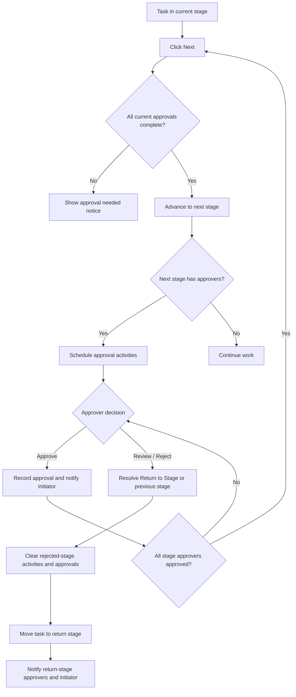

# Project Stage Approval Workflow

## Overview

The workflow is **Project Task → Next → Stage Approvers → Approve or Review**. Each stage can have multiple approvers and an optional **Return to Stage** destination.

## Setup

1. In **Project → Configuration → Task Stages**, edit the stage that **requires approval**.
2. Set the **Approvers** (multiple users allowed).
3. Set **Return to Stage** beside the Approvers field. It is a single stage selection (Many2one).
4. Save. For a project with stages **Design → Artwork Review → Production**, configure **Artwork Review** to return to **Design** if review fails. A stage may instead return to another appropriate earlier stage.
5. If the Return to Stage field is empty, the system falls back to the immediately previous active stage for that project.

## Approve path

1. The task enters a stage with approvers via **Next**.
2. A To-Do activity is scheduled for each pending approver.
3. Each approver clicks **Approve**. Their approval is recorded and their activity completed.
4. The workflow initiator receives an activity for each approval.
5. When all assigned approvers have approved, **Next** can advance the task.

## Review / Reject path

1. An assigned approver clicks **Review**.
2. The current stage's **Return to Stage** is checked. If unset, the prior stage is used.
3. The destination must be active and present on the task's project; otherwise a UserError prevents the move.
4. Current approver's pending activity is completed, other outstanding approval activities for the rejected stage are removed, and the task's approved-user set is cleared.
5. The task moves to the selected return stage. Its approvers, if any, receive new activities.
6. The original workflow initiator receives an activity with the stage and return destination.

## Example

| Stage | Approvers | Return to Stage |
| --- | --- | --- |
| Design | Designer | — |
| Artwork Review | Reviewer A, Reviewer B | Design |
| Production | Production Manager | Artwork Review |

A task in **Artwork Review** can be sent to **Design** by either reviewer using **Review**. After changes, it follows the regular **Next** and approval process again. A task rejected in **Production** is sent to **Artwork Review**.

## Notes

- Return stage settings belong to a stage, not to a particular approver.
- The user-visible button is currently named **Review**, which means rejection/requesting corrections in this workflow.
- No additional access groups are introduced by this change.
- A return stage configured for multiple projects must also belong to the particular task's project.
- Test notification and activity behavior with more than one approver before production rollout.
