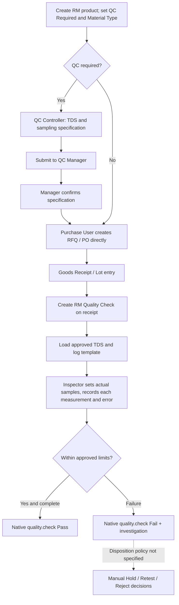

## Purchase Requisition removal — 2026-10-28

**Current module (19.0.1.0.8):** Purchase Requisition models, menu, views, ACLs, approval role and PR number sequence have been removed. The existing `purchase.order.button_confirm()` QC-specification requirement is retained unchanged in `models/purchase_order.py`.

**Upgrade warning:** Existing custom `PRQ/...` records belong to the retired PR models and may be removed from the live database during module upgrade. **Back up the Odoo database and filestore before upgrading.** Previously created standard RFQs/POs are separate `purchase.order` records and are not explicitly modified by this update. Do not uninstall/reinstall the entire module to perform this change; **Upgrade** it.

### Simplified QC Specification workflow (2026-10-28)

- **Excel basis:** `Main Sheet` requests a predefined per-product TDS table, a duplication option, and auto-fetched TDS values for the inspector. It does **not** require an end-user `Load Tests` button or a `Create New Version` workflow.
- **User steps:** Product > Create QC Specification > review pre-filled tests and sampling > Send for QC Approval > Confirm. Repeat purchases reuse the approved specification.
- **Duplication:** Use the standard Action > Duplicate when an alternative draft is needed. A duplicate is never automatically approved.
- **Safety:** Existing saved specifications and inspection snapshots are unchanged; no automatic TDS approval or stock release has been introduced.

## Quick Daily Workflow (Simplified UI - 2026-10-28)

The current interface uses a short sequence:

1. **QC Setup (once per product)**: open the product's **QC Setup** tab, set `Incoming QC Required`, and create a **QC Standard / TDS**. Review automatically populated tests, limits and sample counts, then **Send for QC Approval** and **Approve QC Standard**. Reuse the same approved standard for later purchases.
2. **Purchase Order (standard Odoo)**: create an RFQ directly in Purchase; a QC-required material cannot have its PO confirmed without an approved incoming TDS.
3. **Receive Material**: process the confirmed PO in standard Purchase/Inventory. Open/Create RM Inspection on the incoming receipt.
4. **QC Results**: each test has **Enter Results**. Fill actual measurements, manually judge reference-only tests, and select defect codes only for genuine defects. Pass requires complete, acceptable results; failure and stock disposition remain separate.

Extra sampling details and product properties are still accessible in secondary tabs; no original Excel parameter, condition, or security policy was removed.

# RM QC Specification, Sampling & Quality Check Extension

| Information | Value |
|---|---|
| Technical module | `quality_rm_spec_sampling` |
| Odoo version | 19.0 |
| Module version | 19.0.1.0.8 |
| Author | Softeko_Lamia |
| Documentation updated | 2026-10-28 |
| Source | `RM Master_QC_Specification_With_Sampling.xlsx` (7 sheets) |
| Verification | Python compiled; XML parsed; source import counts validated. **Odoo installation and workflow runtime NOT tested**. |

## Overview

**Extends** standard Odoo 19 models `quality.check`, `product.template`, `stock.picking`, `mrp.production`, and `purchase.order`. This is **not** a replacement for the Odoo Quality app. A Quality Check **is the inspection record**. Its child parameter and measurement rows implement the workbook's multi-log QC format.

## What the actual workbook supplies

| Sheet | Loaded functionality | Count |
|---|---|---:|
| MasterSampleParametersRmcheck | Incoming parameter and sampling templates | 21 |
| MasterSampling_For jobs | Production stage QC/sampling templates | 45 |
| Catalogs error | RM001–RM020 defects | 20 |
| BasicidentificationProduct Spec | configurable product identification fields | 48 |
| Conusmable allocation | reference department/cadence matrix | 43 |
| Main Sheet | specification controller form, inspector log behavior | layout/workflow |
| Rough Work | Original workbook includes PR; this add-on now starts with a standard Odoo PO after QC setup | source context only |

**Original source values are preserved as text:** LSL/Target/USL, UOM, method, sample size, measurement counts, inspection level/frequency. Complex values such as `Nominal - 5%`, `Standard + 0.05`, visual grades, `9.5 / 3.0`, and `AQL 1.0` are not silently interpreted as numeric accept/reject criteria.

## Menu structure

After installation, the module's `RM QC Specification & Sampling` menu appears as a **Quality submenu when detected**; otherwise it appears as its own menu (post-init setup uses installed model actions rather than a guessed Enterprise external ID).

- QC Checks / Inspection Logs (same `quality.check` records, extended form)
- QC Specifications / TDS
- Master Configurations → QC Master Parameters, RM Defect Catalog, Product Identification Templates, Department Consumable Allocation

There is also an **RM QC Inspection** button on incoming stock receipts and **Production QC Checks** on manufacturing orders, plus a **RM QC & Identification** tab on the Product template.

## User flow



**Important:** The custom Purchase Requisition (PR) feature was removed from this add-on in 19.0.1.0.8. Use standard Odoo Purchase RFQs/POs directly. PO confirmation checks for an approved incoming specification **only for products explicitly marked `Incoming QC Required`**. Any independent PR add-on installed outside this module is unaffected.

### Raw Material setup

1. Open Inventory or Products and find the material.
2. Set **Incoming QC Required**, **RM Material Type**, intended use/customer (where relevant), and optional Film Material Grade (BOPP/PET/PE/CPP/MPET/AL).
3. Click **Load Material Identification Fields**, then enter the values. Plate identification fields are available as well.
4. Click **Create QC Specification / TDS**; optionally enter intended customer and usage.
5. QC parameters auto-populate when selecting a product on a new draft; manually add any additional verified tests as needed. For films with selected variant, the loader filters to suitable source items. **AL and MPET do not have a verified incoming sampling master in this workbook**; build and approve a verified specification manually rather than borrowing PET tolerances.
6. Enter product-specific nominal numeric values where required; tick *Nominal Value Entered*, save and press **Resolve Nominal +/- Limits** on the relevant parameter row. This supports explicit `Nominal ± amount` or `Nominal ± percentage`. Other expressions must be manually approved as numeric limits or kept as reference/manual tests.
7. Submit to QC Manager, then have a user in **QC Manager** group confirm. Approved specifications are locked; **Action > Duplicate** creates a fresh draft for the workbook-requested duplication (not automatic version approval); prior inspections remain unchanged.

### Direct purchase order / RFQ

- Use standard **Purchase → Requests for Quotation** to create an RFQ directly (there is no PR screen in this module).
- For QC-required products, approved incoming QC standards must exist before **Confirm Order**; non-QC products are unaffected.
- The PO uses Odoo's standard vendor, price, taxes, approval and stock receipt processes. The removed PR workflow is not required.

### Incoming inspection on a receipt

1. Select incoming receipt, including a receipt already **Done**; batch/lot entries should already be present.
2. Click **RM QC Inspection**. The code creates at most one new `quality.check` per **Product × Lot × Approved Specification** within that receipt, and reuses prior matches. If the product is not flagged QC Required, no custom check is created for it.
3. Open a check from the custom Detailed QC view. Approved specification parameters and sampling rules are snapshotted into inspection parameter lines.
4. Open each parameter, adjust **Actual Samples to Test** for the receipt's actual number of pallets/rolls (a default per-unit value is only a starting point), click **Generate Missing Sample Logs**.
5. Enter each `Measured Value / Result`. For numeric and verified limits, the outcome is calculated. For visual, text, formula or AQL criteria, enter **Manual Evaluation** after inspection.
6. Enter the applicable **RM001–RM020 Catalog Error** *per log* when a defect exists.
7. Use the **standard quality.check Pass** only after **all expected measurements are complete** and within limits / manually passed. The module intercepts `do_pass`, `do_measure` and state write to prevent an unsupported Pass for these specification-linked checks. **Fail** is always available.

**Pass is an inspection outcome, not a stock-release authorization.** The workbook doesn't specify whether a receipt should be blocked, held, returned, or re-tested based on failed QC. This add-on intentionally does **not** automatically change stock, create stock scrap or block validated receipts.

### Production QC

- The 45 master parameters are grouped into the source stages: Pre-Press Setup, Live Press Run, Post-Print QC, Lamination, Slitting, Pouch Making, Valving.
- For a manufactured product, create/approve one or more **Production** specifications (set the exact stage before loading the master).
- Use **Production QC Checks** on the Manufacturing Order to create stage-level `quality.check` records linked to that MO. It does not automatically stop production on failures or enforce a timed frequency schedule. Timed checks (e.g. every 30 minutes) require the responsible team to run the checks and/or separate scheduling configuration.

### Consumable allocation

43 rows and 12 department flags are displayed as a **reference matrix**. `As per ROP`, `Single time`, and `Mixed` retain their original labels. **No new reordering points, requisitions, or stock moves are created** by this matrix. Original 0/1 flags are treated as applicability flags, not quantities.

## Conditions and validations

| Trigger | Rule | Result |
|---|---|---|
| Submit TDS | Specification requires at least one parameter | Block empty submission |
| QC Manager confirms TDS | Caller belongs to QC Manager group | Store confirmation/time |
| Edit confirmed TDS | Source snapshot is locked | Duplicate a new draft |
| Confirm PO | Same condition for flagged RM; non-QC unaffected | Block PO otherwise |
| Generate receipt QC | Incoming only, QC required, match product, lot and company | Create linked checks; avoid duplicate |
| Generate logs | `Actual Samples × Measurements per Sample`, max 3000 | Add only missing rows |
| Pass linked Quality Check | Every required log exists and has an evaluated result; no failed/out-of-spec measurement | Pass permitted only after completion |
| QC Fail | Native Odoo quality check | Fail allowed; disposition remains manual |

## Workbook gaps / decisions for the company

1. No verified full **AQL accept/reject table** (Ac/Re values, defect classification): the inspection level is recorded but does not auto-accept an entire shipment.
2. No approved **stock hold/release/reject/retest** flow, or whether incoming inspection is mandatory *before* receipt validation. No stock blocking implemented.
3. No Incoming QC Manager sign-off rule per individual inspection (the workbook confirms **TDS** through the QC Manager, not explicitly each inspection).
4. No precise formula for all limits (`Standard +0.05`, textual grades, combined measurements). These are manual/reference until approved.
5. Per-pallet sample rules need the real pallet/roll count; this is captured by **Actual Samples to Test**, not guessed.
6. No verified incoming AL/MPET specification in source; do not automatically apply PET limits.
7. Master production frequency is descriptive; no background scheduler or MRP operation stop gate was requested explicitly.
8. Consumable matrix is reference only; ROP/quantity semantics need validation.

## Security — temporary open access for internal users (19.0.1.0.1)

All **logged-in internal users** (`base.group_user`), including Administrator, have full CRUD rights for the remaining **QC custom models**. All QC menus and workflow buttons are accessible within their native Odoo app permissions. The removed PR groups and access rules are no longer part of this add-on. This broad-access test configuration should be restricted for production.

**Scope:** Does not grant permissions to portal/public users, nor override standard Odoo Product/Purchase/Quality/Inventory/Manufacturing access rights. Standard RFQ/PO creation still requires the normal Odoo Purchase permissions. The extension root may be nested under Quality depending on the installed menu structure.

**Business safety:** QC-required products still need approved specifications for PO confirmation; approved TDS is still locked for revision; QC Pass still requires completed valid measurements. Company record rules stay in force.

**Before production:** Restore specific QC Controller/Manager roles and tighter ACLs. Simply hiding a button/menu using Access Management may not prevent backend method calls; reapply security server-side too. This temporary test configuration deliberately grants broad master record deletion rights to internal users—use a staging database and backups.

## Installation

1. Back up the Odoo database and filestore; use a staging DB first.
2. Ensure Odoo **19.0**, Enterprise Quality app, Inventory, Purchase and Manufacturing are installed. This module depends on `quality`, `quality_control`, `stock`, `purchase`, `mrp`, `mail`.
3. Unzip and place `quality_rm_spec_sampling/` inside an addons directory included in `addons_path`.
4. Restart Odoo, Apps → Update Apps List, search **RM QC Specification, Sampling & Quality Check Extension** and Install.
5. Assign custom and existing Quality/Purchase groups and test with a new raw material before using production data.
6. For CLI installation (adjust paths and DB name):
   ```bash
   ./odoo-bin -c /path/to/odoo.conf -d YOUR_DB -i quality_rm_spec_sampling --stop-after-init
   ```
7. To upgrade after code changes, use `-u quality_rm_spec_sampling` and restart Odoo.

## Proposed QA scenarios (NOT executed)

| ID | Test |
|---|---|
| QC01 | 21 incoming and 45 production master rows appear with exact source values |
| QC02 | Defects RM001–RM020 imported without duplicates |
| QC03 | QC Controller creates PET specification and resolves 12 ±5% -> 11.4–12.6 |
| QC04 | Spec cannot be confirmed by inspector, or modified after confirmation |
| QC05 | Create a standard RFQ without PR; QC-required PO confirmation requires approved TDS; non-QC PO does not |
| QC06 | Confirm PO for QC-required item without TDS is blocked; unflagged item unaffected |
| QC07 | Done receipt with two different lots creates two quality.check records; rerun avoids duplicates |
| QC08 | Inspector cannot Pass before every log is populated; failed numeric log prevents Pass |
| QC09 | Same log records RM001 and appears in QC inspection record |
| QC10 | Production MO creates one QC Check per approved production stage |
| QC11 | Existing standard Quality Checks for products without this module's specs behave unchanged |
| QC12 | Permissions, different companies, missing batches and approval routes |

## Technical mapping

| Model | Purpose |
|---|---|
| `quality.check` (inherited) | Native inspection with added TDS, product/PO/batch, sampling lines |
| `rm.qc.inspection.parameter` / `rm.qc.inspection.log` | Snapshot and sample × measurement lines, defect reference |
| `rm.qc.specification` / `.line` | TDS approved version and material sampling master |
| `rm.qc.parameter.template` | 21 incoming / 45 production source parameter masters |
| `rm.qc.defect` | 20 predefined errors |
| `product.template` (inherited) | Incoming QC Required flag, type, identification |
| `stock.picking` (inherited) | Create/check receipt-based QC inspections |
| `mrp.production` (inherited) | Stage-wise Production QC check creation |
| `rm.qc.consumable.allocation` | 43 reference rows |

This ZIP does not modify Standard Quality app files. The test results refer to **static source checks only**, not installation or real Odoo transaction tests.


## UI layout (2026-10-28)

This UI-focused update follows the source workbook’s separation of **Basic Product Identification**, **TDS / QC Controller setup**, and **Incoming QC Inspector logs**. The underlying records and workflows are unchanged.

1. On the product, use **RM QC** to classify the product, load and fill Product Property Templates, and navigate to a new/approved TDS. The Property table describes the product; it is **not** a measured receipt result.
2. In **QC Specifications / TDS**, load Excel-based tests; click each MIC to edit TDS LSL/Target/USL, numeric acceptance limits, method, sampling count and frequency. Submit for confirmation. The approved TDS is reusable for future receipts; revised TDS needs a new draft.
3. For a received batch, open **QC Inspections / Quality Checks**; click **Enter Results** on each MIC, adjust the actual sample count and generate measurement rows. Enter actual test results and errors; run the existing validated Pass action after completion.

The spreadsheet does not define a complete AQL batch disposition/stock release policy. **Automatic whole-check Pass/Fail and stock blocks were not added in this UI update.**

### UI update verification

XML parse, Python compilation, record references and ZIP extraction are statically checked. Live installation and UI clicks in an Odoo 19 database are not verified.


## Product smart-button navigation (19.0.1.0.6)

The Product form has one **QC Standards** smart button in its upper smart-button row.
The counter includes all accessible QCS records associated with the Product, including archived records.
Clicking opens a list filtered to that Product; **New** starts a draft QCS prefilled with the Product (Incoming RM scope).
The former lower **Create QC Standard / TDS** button and duplicate embedded QCS list are hidden from the Product form.
Existing QCS data and the underlying creation method remain intact for compatibility.
This is a UI/navigation update only; business validations and approvals are unchanged.


### Product Properties — Automatic Configuration (19.0.1.0.7)

Manage property definitions at **RM Quality → More / Master Data → Product Property Configuration**. Each master field has a Material Type, Property Name, optional Default Unit, Sequence, and Active flag. When a Product is created, or its RM Material Type changes, the corresponding technical property lines are generated/synchronized automatically. Product users fill in Value and Unit, not the property name. No **Load Property Templates** action is required.

Existing product properties are synchronized by the 19.0.1.0.7 post-upgrade script. Unrelated/duplicate property records are disabled rather than deleted so previously entered data remains available for material-type reversal. The QC TDS tolerance and sampling rules remain separate from product identification properties.
