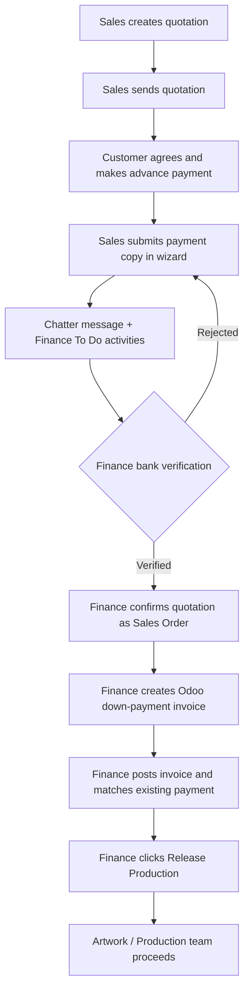

# Sale Finance Advance Approval — Odoo 19

| Property | Value |
|---|---|
| Technical name | `sale_finance_advance_control` |
| Version | `19.0.1.0.0` |
| Author | Softeko_Lamia |
| Documentation updated | 2026-11-19 |
| Dependencies | `sale_management`, `account`, `mail` |
| Runtime QA | **Not executed**; source/static checks only |

## Business purpose

Require finance to verify a customer's **actual credited advance payment** before quotation confirmation and before invoicing the resulting Sales Order.

## Agreed business flow

## Installation

1. Place the `sale_finance_advance_control` directory in your Odoo 19 custom-addons path.
2. Update the Apps list; install **Sale Finance Advance Approval**.
3. Assign finance users to **Finance Sales Approval / Finance Approver** in Settings → Users.
4. Also grant Finance users appropriate Accounting/Billing rights to post and reconcile invoices.
5. Configure the Sales, Accounting, and production process for your products.
6. Test with separate Sales and Finance users in a **staging database** before use.

## Sales user flow

1. Sales → Quotations → New; create and send a quotation.
2. After customer accepts and pays, click **Submit Payment Proof**.
3. Upload the payment copy, claimed advance amount, and transfer reference.
4. The module puts the copy in the quotation's **Chatter**, marks verification **Pending Finance Review**, and creates a Finance activity for every assigned active Finance Approver (avoiding duplicate activities).
5. Sales cannot confirm the quotation or create invoices through the Sales Order workflow.

## Finance user flow

1. Read the activity and chatter; verify the credit in the bank **outside Odoo**.
2. If not credited, select **Reject Proof**. Sales can then resubmit a new copy.
3. If credited, click **Verify Payment**; the module stores the verifier and timestamp.
4. Click **Confirm**; it changes the quotation into a confirmed Sales Order.
5. Click **Create Invoice** and choose Odoo's standard **Down payment (fixed amount)** or **Down payment (percentage)**. Use the appropriate amount and tax treatment.
6. **Post** the invoice. Match/reconcile the existing advance payment correctly instead of registering it twice.
7. Click **Release Production** to mark the order **Released** (requires a posted SO-linked customer invoice).

## Important limitations / integration notes

- **Payment verification is a manual Finance attestation.** There is no automatic bank integration or verified-bank-statement lookup in this module. Never treat an uploaded receipt as proof the bank was credited.
- Odoo's **standard Sales Order invoicing is after confirmation**. This addon does **not** create a linked invoice from an unconfirmed quotation. Finance can create separate manual invoices in Accounting using Odoo standard options, but those do **not** automatically become linked down payments on the quotation.
- **Production Release is an approval status and button, not an MRP/work-order security gate.** Odoo may generate deliveries or manufacturing orders on Sales Order confirmation depending on routes. If your artwork, MRP, stock, or external production workflow must be technically blocked, extend that specific workflow to require `sale.order.production_release_state == 'released'` before starting production.
- The Release Production button requires a **posted** linked customer invoice. It does not automatically prove the invoice is paid; Finance must check reconciliation and actual bank credit. Strong automated reconciliation gating would be a further customization.
- Portal acceptance / online payment flows and third-party automation that directly confirm quotations may be blocked by the Finance-only confirmation restriction. Review those flows before deployment.
- Normal Odoo administrator/superuser capabilities, migrations, and other custom modules can affect security. Review integration points and test end to end.
- No Odoo server/database is provided here; **installation, end-to-end tests, and security penetration tests have not been run**.

## Functional / technical reference

| Object | Usage |
|---|---|
| `sale.order.action_open_payment_proof_wizard` | Opens Sales proof-submission wizard |
| `sale.finance.payment.submit.wizard.action_submit` | Uploads attachment to chatter, marks pending, schedules Finance activities |
| `sale.order.action_verify_advance_payment` | Finance verifies manually and records attribution |
| `sale.order.action_reject_advance_payment` | Finance rejects the document and allows new proof |
| `sale.order.action_confirm` + `write` | Blocks unauthorized or unverified confirmation in backend |
| `sale.order._create_invoices` | Blocks non-Finance SO invoicing |
| `sale.advance.payment.inv.create_invoices` / `_create_invoices` | Blocks unauthorized down-payment wizard invoicing |
| `sale.order.action_release_production` | Flags approval once linked invoice is posted |
| `security/security.xml` | Odoo 19 `res.groups.privilege`, Finance Approver group |
| `security/ir.model.access.csv` | ACL for transient payment-upload wizard |
| `views/sale_order_views.xml` | View buttons, finance review tab and list status |

### Custom fields on `sale.order`

`payment_verification_state`, `advance_payment_amount`, `advance_payment_reference`, `payment_proof_attachment_id`, `payment_verified_by`, `payment_verified_on`, `production_release_state`, `production_released_by`, `production_released_on`.

## Proposed manual QA scenarios (not executed)

| ID | Steps | Expected |
|---|---|---|
| QA-01 | Sales drafts and sends quotation | Can submit proof, cannot confirm |
| QA-02 | Sales submits valid proof | Attachment in chatter and Finance activities scheduled |
| QA-03 | Sales attempts `action_confirm` by RPC | AccessError |
| QA-04 | Sales writes `state='sale'` by RPC | AccessError |
| QA-05 | Finance confirms without verification | UserError |
| QA-06 | Finance rejects, Sales resubmits | State returns to pending |
| QA-07 | Finance verifies then confirms | Sales Order becomes confirmed |
| QA-08 | Sales opens SO invoicing wizard by direct call | AccessError |
| QA-09 | Finance creates & posts down payment invoice | Linked invoice shown on Sales Order |
| QA-10 | Finance releases before posted invoice | UserError |
| QA-11 | Finance releases after posted invoice | Status becomes Released |
| QA-12 | Customer portal tries to confirm a quotation | Must be reviewed for integration compatibility |
| QA-13 | Sales re-submits after verification | Blocked |
| QA-14 | Existing payment matched with invoice | No duplicate accounting entry |

## Version history

See [CHANGELOG.md](CHANGELOG.md).
